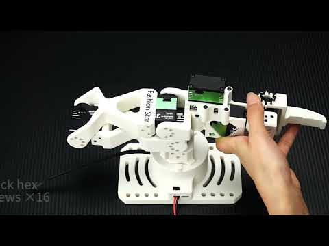
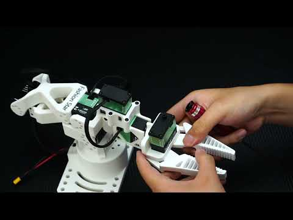
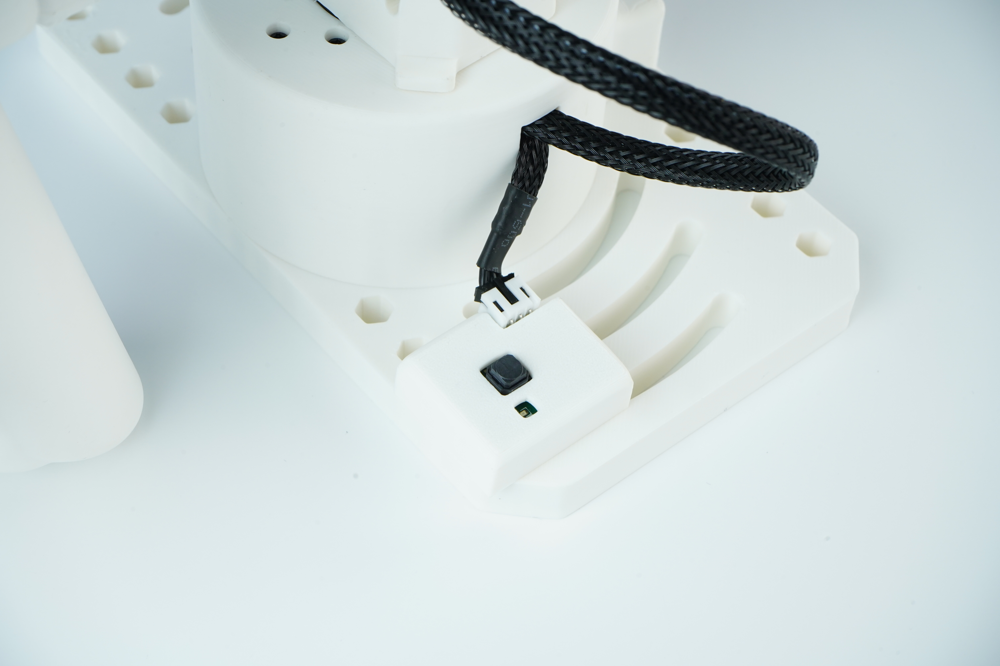

# DIY 装配与校准

[← 文档目录](../)　|　[English](README.md) / **简体中文**

在本页完成 Star Arm 102 的装配与使用准备：组装机械臂、接线、零位校准、按型号设置并写入 PID 参数，最后检查关节运动。已完成装配、配置与校准的整机，可直接进入[开始使用](../getting-started.zh.md)。

**目录：**

- [🎬 装配视频](#assembly-videos)
- [🔘 HD 按钮安装与接线](#button-installation-wiring)
- [🔌 接线与通信](#wiring)
- [🎯 零位校准](#zero-calibration)
- [⚙️ PID 设置与写入](#pid-settings)
- [✅ 检查与开始使用](#check-and-continue)

BOM、CAD（STEP）、URDF 与 3D 打印文件：[102-LD](../../hardware/102-ld/) · [102-HD](../../hardware/102-hd/) · [102-FL](../../hardware/102-fl/)。

## 🎬 装配视频

点击封面或下方链接，在 YouTube 观看对应教程。

<table>
<tr>
<td width="50%" valign="top">

<h3>🦾 102-LD/HD 主体装配</h3>

LD 按视频装配；HD 使用配套的对应紫色空心杯总线舵机，其余主体装配步骤相同。

<a href="https://www.youtube.com/watch?v=flTCgBx3K0M">▶ 在 YouTube 观看</a>

</td>
<td width="50%" valign="top">

<h3>🦾 102-FL 主体装配</h3>

按视频完成 102-FL 从臂的主体装配。

<a href="https://www.youtube.com/watch?v=9-ufaI8dwys">▶ 在 YouTube 观看</a>

</td>
</tr>
<tr>
<td width="50%" valign="top">

<h3>🤏 柔性夹爪装配</h3>

柔性夹爪的更换与装配。零件与 BOM 见<a href="../../hardware/flexible-gripper/">柔性夹爪硬件资料</a>。

<a href="https://www.youtube.com/watch?v=lqLOFoPuTgw">▶ 在 YouTube 观看</a>

</td>
<td width="50%" valign="top">

<h3>📷 摄像头模组装配</h3>

<strong>装配视频待上线。</strong>

零件与 BOM 见<a href="../../hardware/camera-module/">摄像头模组硬件资料</a>。

</td>
</tr>
</table>

## 🔘 HD 按钮安装与接线

参考照片检查按钮模块在底座上的安装位置、接头方向及线缆走向。点击可查看原图。

## 🔌 接线与通信

按[电源、接线与串口识别](../getting-started.zh.md#connect)完成连接，再执行[通信检查](../../python-sdk/README.md#check-communication-without-commanding-motion)。之后回到本页，先完成零位校准，再按适用型号设置并写入 PID 参数。

## 🎯 零位校准

LD、HD、FL 均需使用正确的参考姿态和零位定义。本节适用于 DIY 装配、拆装关节或更换舵机后的校准。

**零位姿态图片与设置步骤待补充。** 在说明补齐前，请通过 [Fashion Star 支持](https://fashionstar.com.hk/support/) 确认当前硬件版本的校准方法。

硬件零位校准、多圈计数重置和 LeRobot 校准是不同的操作。Python 直接遥操作脚本在连接时重置多圈计数，并不会执行 LeRobot 校准。请按所选软件指南完成其要求的额外校准。

## ⚙️ PID 设置与写入

完成零位校准后，再设置并写入 PID 参数。

| 型号 | 适用情况 | 操作说明 |
| --- | --- | --- |
| 102-LD | 无电机的示教主臂，不适用 HD／FL 的电机 PID 设置流程 | 无需电机 PID 设置 |
| 102-HD | 有电机的姿态保持主臂，按对应舵机型号与固件设置 | 参数表与操作步骤待补充 |
| 102-FL | 有电机的执行从臂，按对应舵机型号与固件设置 | 参数表与操作步骤待补充 |

可用工具见[控制与配置工具](../../tools/README.md#choose-a-tool)。本页尚未提供经确认的各关节 PID 数值及写入、保存步骤，请勿跨型号或固件版本照搬参数。

## ✅ 检查与开始使用

首次使用前，确认装配与接线完成、通信正常，且已完成零位校准及适用的 PID 参数设置与写入。按所选软件指南，小幅检查关节方向与运动。如果运动或反馈异常，请停止并检查配置；停止方式见[参考姿态与停止操作](../getting-started.zh.md#reference-pose-and-stopping)。

**[继续开始使用 →](../getting-started.zh.md#digital-twin)**
