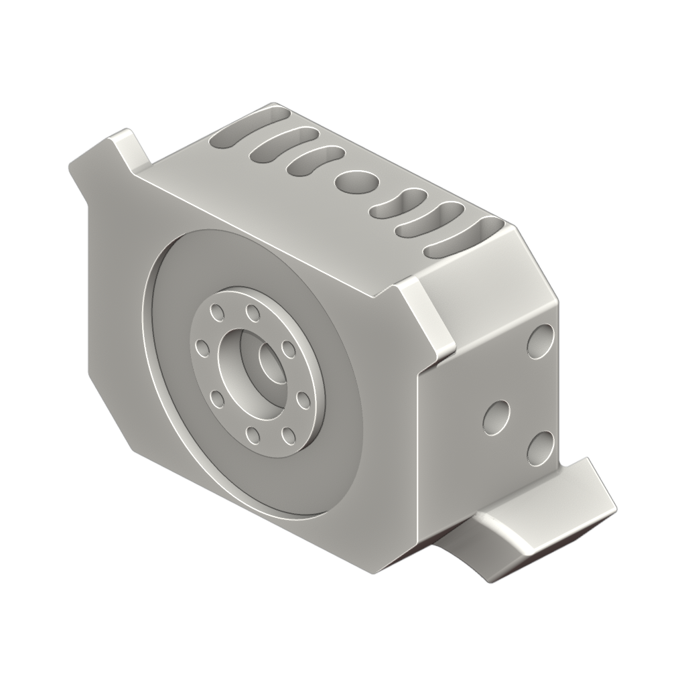
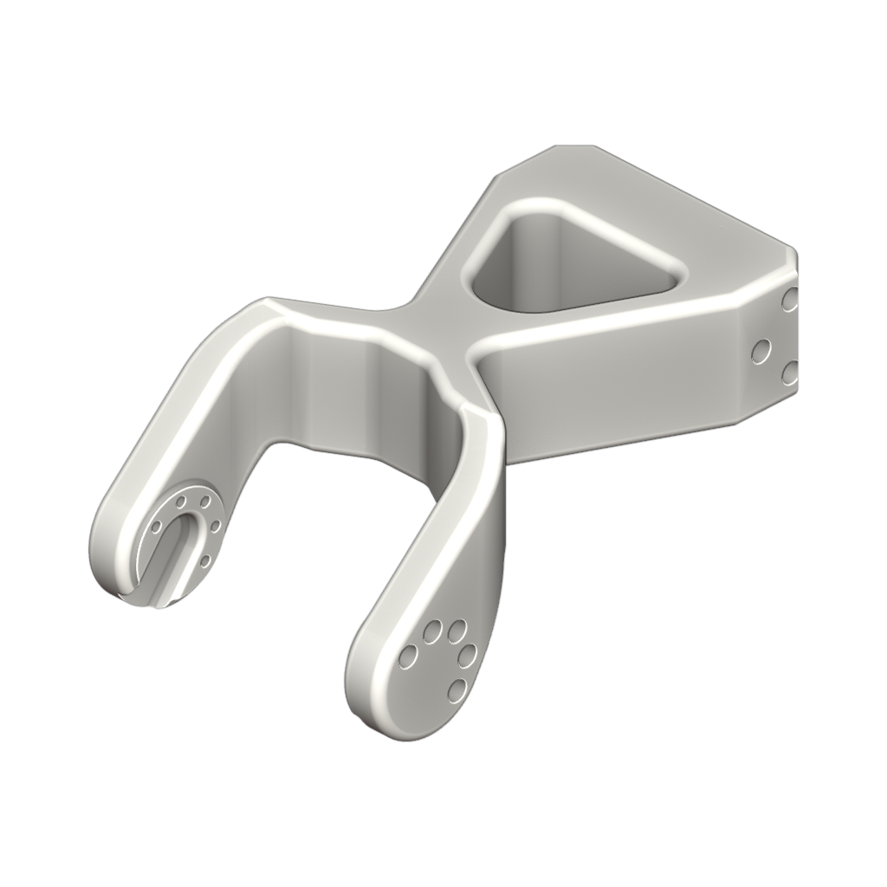
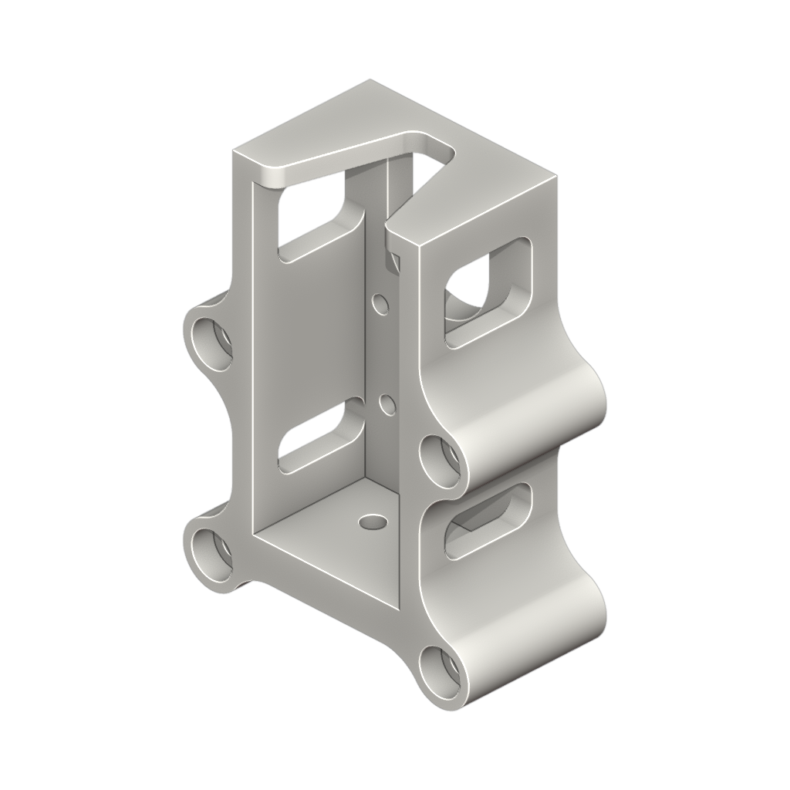
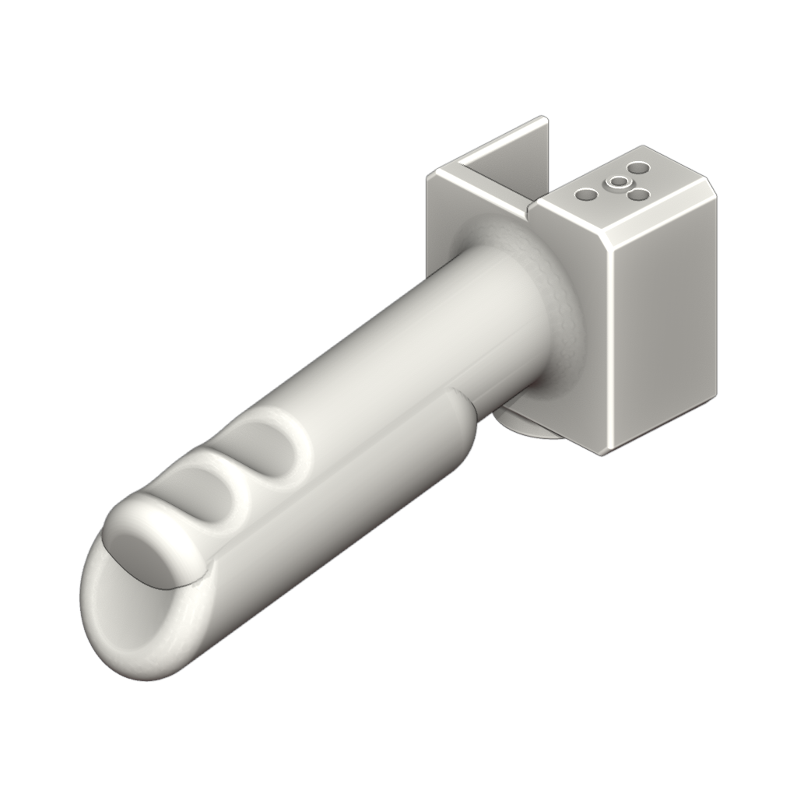
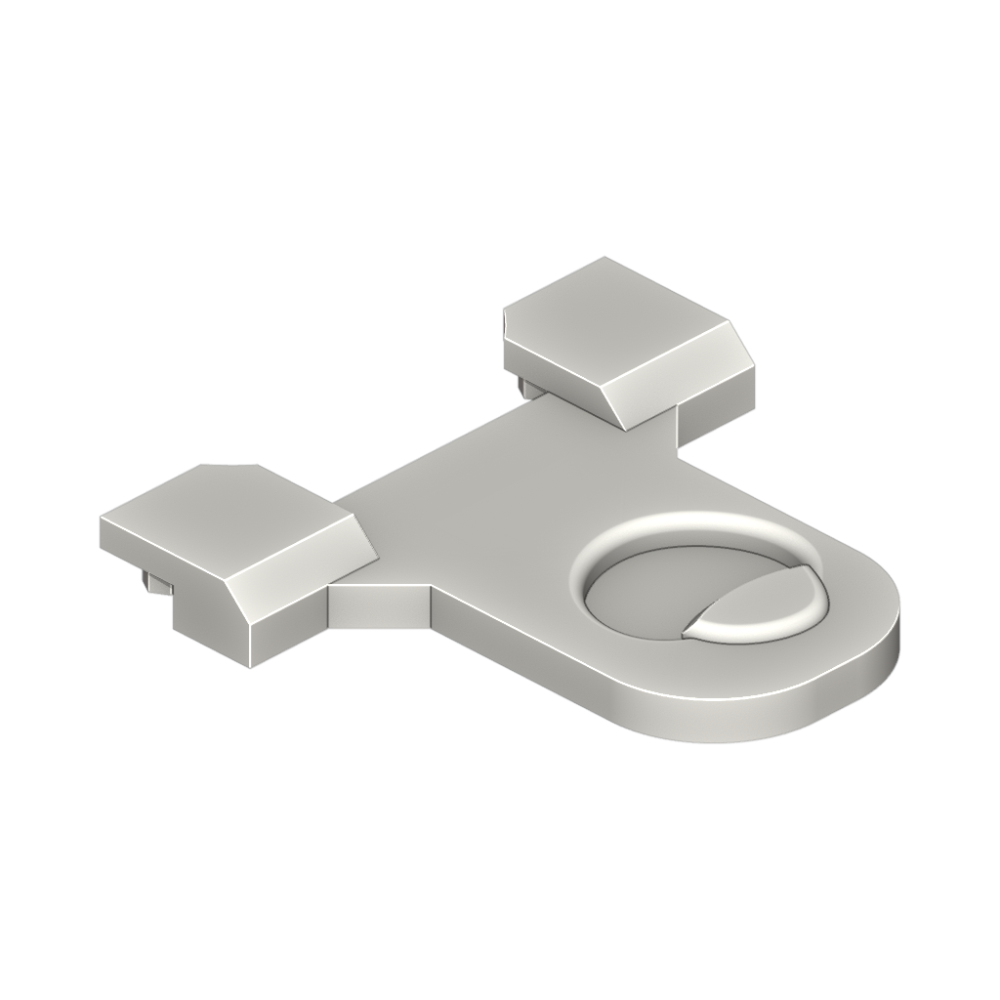
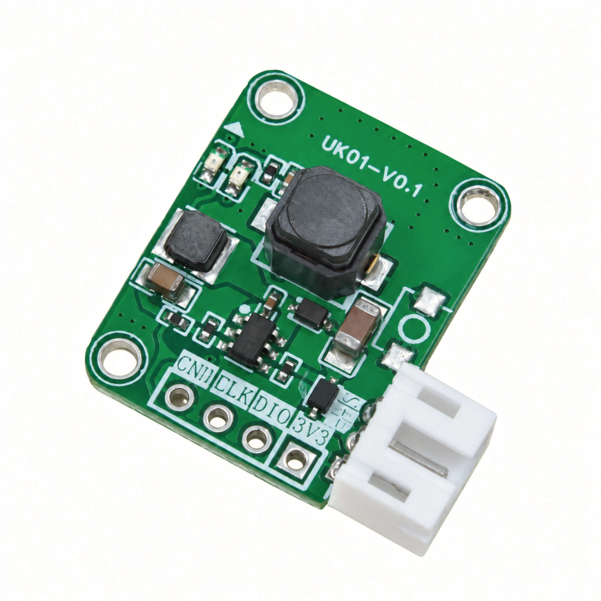

# Star Arm 102-HD hardware

[← Hardware Resources](../README.md)　|　**English** / [简体中文](README.zh.md)

  
  
  
  
  
  

**Contents:**

- [📂 Resources](#resources)
- [📋 Bill of Materials](#bill-of-materials)
- [🔢 Joint and servo ID mapping](../../docs/specifications.md#joint-ids-and-names)

## Resources

| Directory | Description | Status |
| --- | --- | --- |
| [Assembly guide](../../docs/diy-assembly/README.md#102-hd) | Main arm video with HD servo substitution and button wiring photo | ✅ Complete |
| [step/](step/) | Part models in parts/; shared assembly in assembly/ | ✅ Complete |
| [printing/](printing/) | STL: [View parts](printing/stl/) · [Download ZIP](printing/star-arm-102-hd-stl.zip) | ✅ Complete |
| [drawings/](../102-ld/drawings/) | Shared LD/HD body drawings (PDF / DWG) | ✅ Complete |
| [robot-description/](robot-description/) | URDF model: [Browse source](robot-description/) · [Download ZIP](robot-description/star-arm-102-ld-hd-urdf.zip) | ✅ Complete |

## Bill of Materials

The table below lists **32 assembly items** for 102-HD. Missing images are marked pending.

For printed parts, Model / Specification lists the part identifier. Except for Link 6, identifiers match the supplied STEP and STL filenames (without extensions); existing Link 6 files are named `star-arm-102-link6-handle`. The handle support is currently provided as a STEP model. Print settings are not recorded here: take the STL from [printing/stl/](printing/stl/) and slice it for your own printer, because layer height, wall count and infill depend on the machine and filament used.

Printed-part images are rendered from the corresponding STEP models. Fastener images are AI-generated illustrations; refer to the table text for specifications. Click an image to enlarge it.

| No. | Part Name | Model / Specification | Image | Description | Quantity |
| :---: | --- | --- | :---: | --- | :---: |
| 1 | UART bus servo | RP8-U45H-M |  | 12V; 45kg-cm; 118rpm; Dual-shaft; Coreless Motor; 12-bit Magnetic Absolute Encoder; 25T | 4 |
| 2 | UART bus servo | RP8-U45H-M-C028 |  | 12V; 45kg-cm; 118rpm; Dual-shaft Housing (Flat Bottom Cover, No Rear Output Shaft); Coreless Motor; 12-bit Magnetic Absolute Encoder; 25T | 2 |
| 3 | UART bus servo | RP8-U45H-M-C029 |  | 12V; 45kg-cm; 118rpm; Dual-shaft Housing (Flat Bottom Cover, No Rear Output Shaft); Coreless Motor; 12-bit Magnetic Absolute Encoder; D-Type Shaft | 1 |
| 4 | Base bottom plate | star-arm-102-base-bottom |  | Ivory, PLA 3D printed part | 1 |
| 5 | Base top plate | star-arm-102-base-top |  | Ivory, PLA 3D printed part | 1 |
| 6 | Link 1 | star-arm-102-link1 |  | Ivory, PLA 3D printed part | 1 |
| 7 | Link 2 | star-arm-102-link2 |  | Ivory, PLA 3D printed part | 1 |
| 8 | Link 3 | star-arm-102-link3 |  | Ivory + black, PLA 3D printed part | 1 |
| 9 | Link 4 | star-arm-102-link4 |  | Ivory, PLA 3D printed part | 1 |
| 10 | Link 5 | star-arm-102-link5 |  | Ivory, PLA 3D printed part | 1 |
| 11 | Link 6 | star-arm-102-link6 |  | Ivory, PLA 3D printed part | 1 |
| 12 | Handle | star-arm-102-handle |  | Ivory, PLA 3D printed part | 1 |
| 13 | Handle support | [star-arm-102-handle-support](step/parts/star-arm-102-handle-support.step) |  | 3D printed part; supports the handle from below | 1 |
| 14 | Left finger ring | star-arm-102-finger-ring-left |  | Ivory, PLA 3D printed part | 1 |
| 15 | Right finger ring | star-arm-102-finger-ring-right |  | Ivory, PLA 3D printed part | 1 |
| 16 | HD button cover | hd-button-cover |  | Ivory, PLA 3D printed part | 1 |
| 17 | HD button base | hd-button-base |  | Ivory, PLA 3D printed part | 1 |
| 18 | TTL/USB Servo Adapter | UC-01 |  | USB Type-C; half-/full-duplex conversion; selectable 3.3 V / 5 V TTL levels; 6–15 V input; 2 × PH2.0 servo ports; reverse-polarity protection XT30 connector | 1 |
| 19 | Button board | UK-01 |  | With socket | 1 |
| 20 | Thrust needle roller bearing | AXK2035+2AS |  | inner diameter 20 mm, outer diameter 35 mm, thickness 4 mm | 1 |
| 21 | Servo cable | PH2.0 (PH-3Y) 120 mm |  | Black silicone-insulated ribbon cable with black braided sleeving; reversed pin order between ends; 60 × Ø0.08 mm strands per conductor (approx. 22 AWG) | 6 |
| 22 | Servo cable | PH2.0 (PH-3Y) 200 mm |  | Black silicone-insulated ribbon cable with black braided sleeving; reversed pin order between ends; 60 × Ø0.08 mm strands per conductor (approx. 22 AWG) | 2 |
| 23 | Hexagon socket head cap screw | M3 × 22 |  | Black finish | 4 |
| 24 | Hexagon socket head cap screw | M3 × 10 |  | Black finish, property class 12.9 | 1 |
| 25 | Hexagon socket head cap screw | M2 × 10 |  | Black finish | 8 |
| 26 | Hexagon socket head cap screw | M2 × 8 |  | Black finish | 8 |
| 27 | Phillips countersunk head self-tapping screw | 3 × 12 mm |  | Silver finish; pointed tip | 2 |
| 28 | Phillips pan head machine screw | M3 × 10 |  | Black finish, hardened | 1 |
| 29 | Phillips pan head self-tapping screw | 2 × 5 mm |  | Black finish, hardened; blunt point | 46 |
| 30 | Phillips pan head machine screw | M2 × 4.5 |  | Black finish; blue pre-applied threadlocker on approximately the lower two-thirds of the threaded shank (toward the tip) | 35 |
| 31 | Nut | M3 |  | Black finish | 5 |
| 32 | Washer | M3 (3 × 6 × 0.5 mm) |  | Stainless steel | 1 |

Found an error in these resources or need help? Contact our [Support Hub](https://fashionstar.com.hk/support/) with your model and the relevant file or item.
