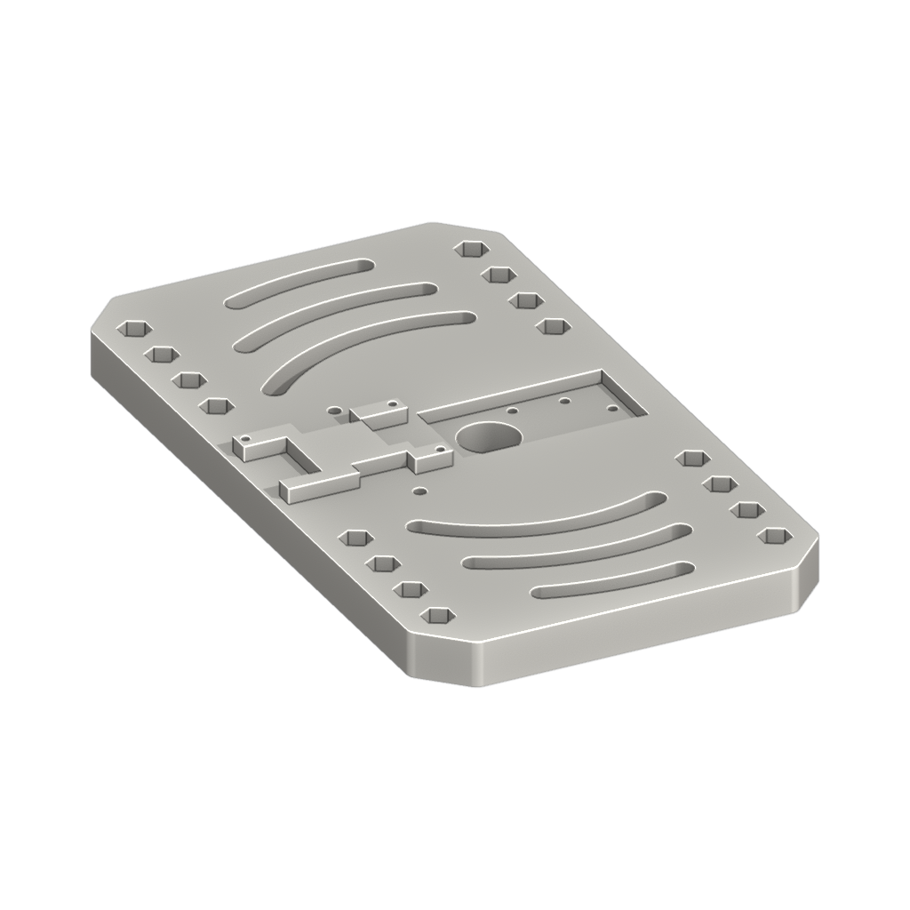
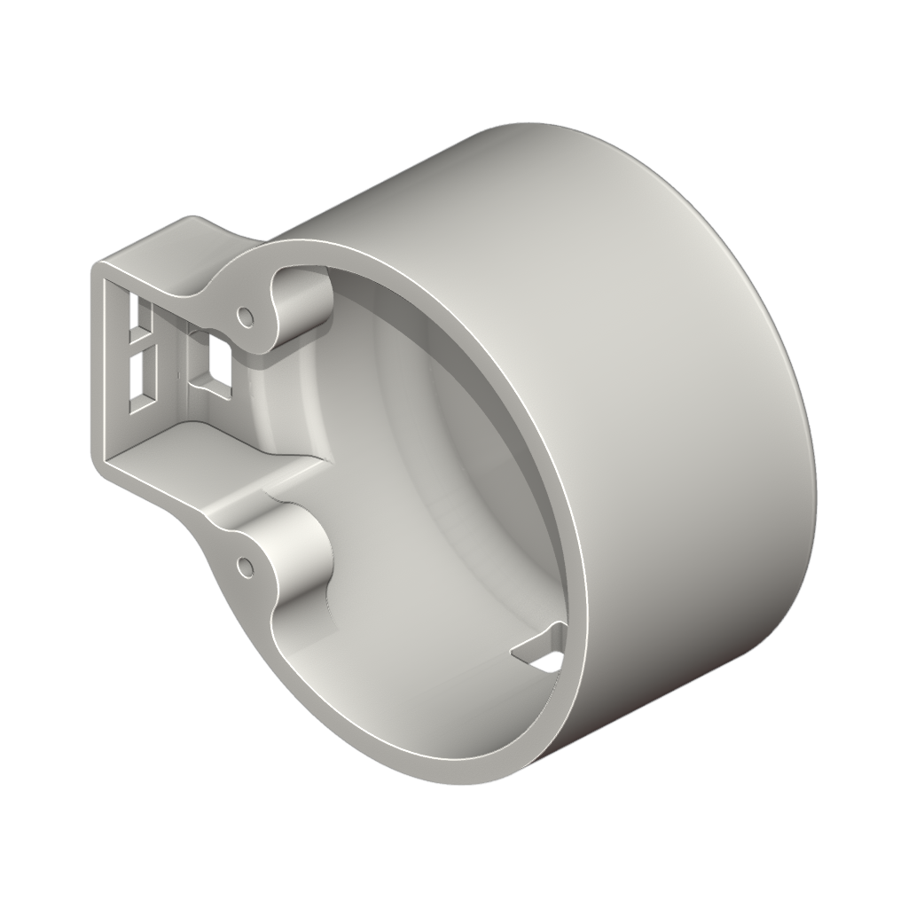
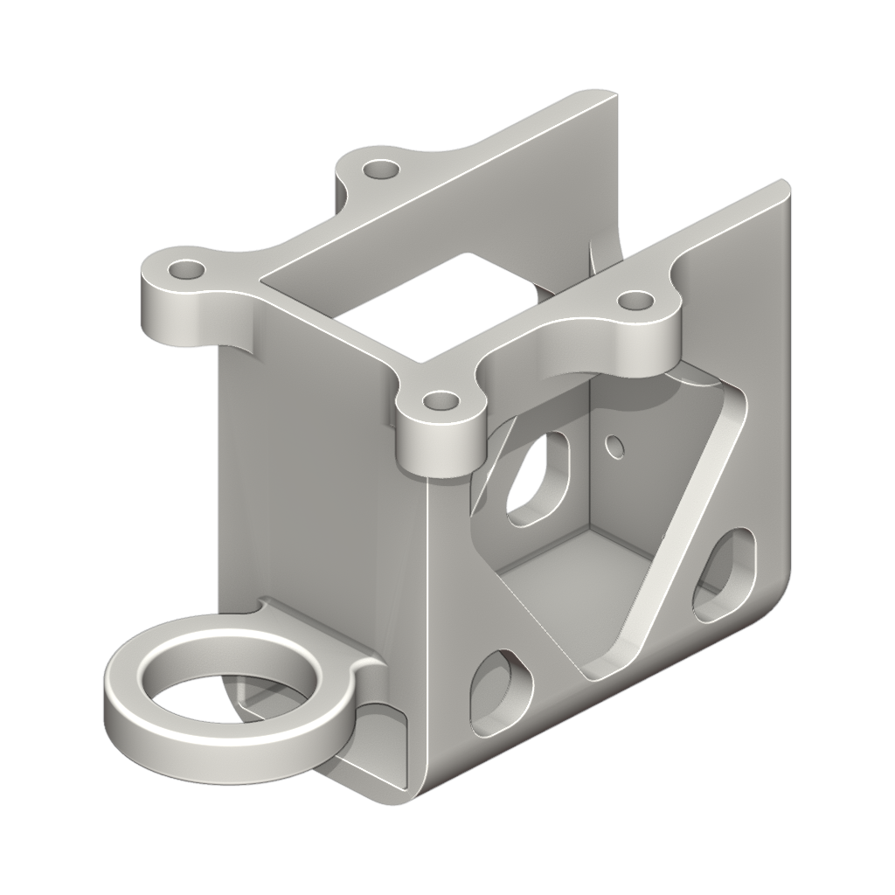
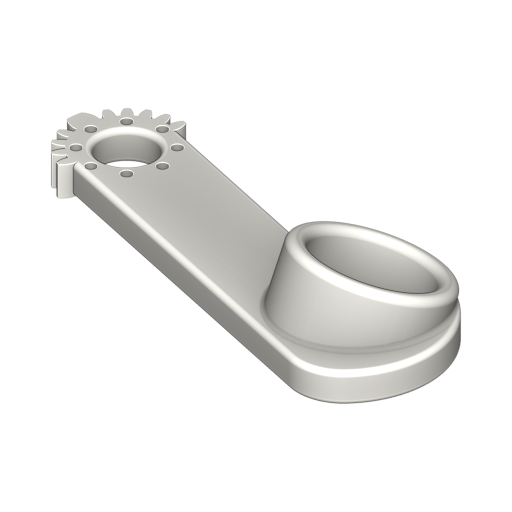
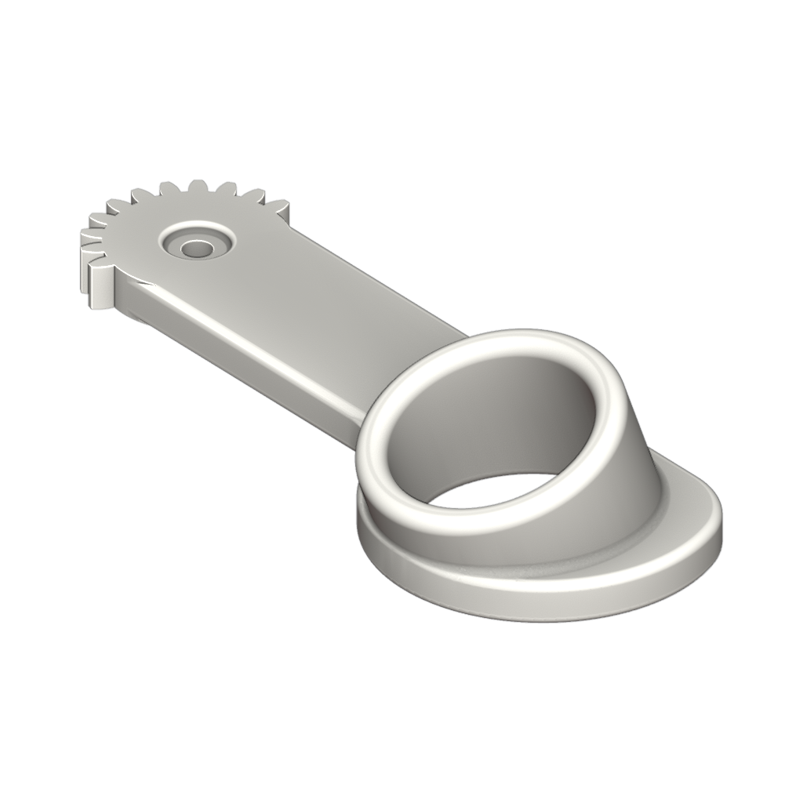
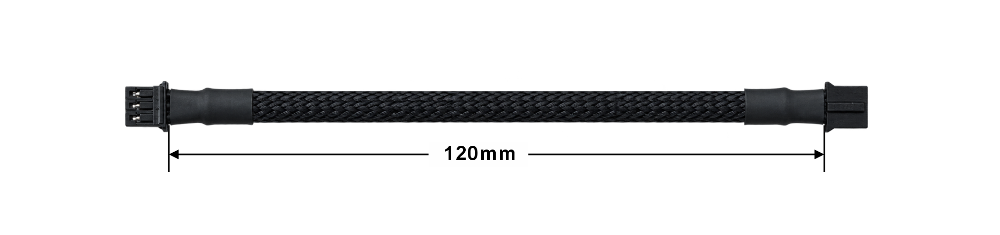
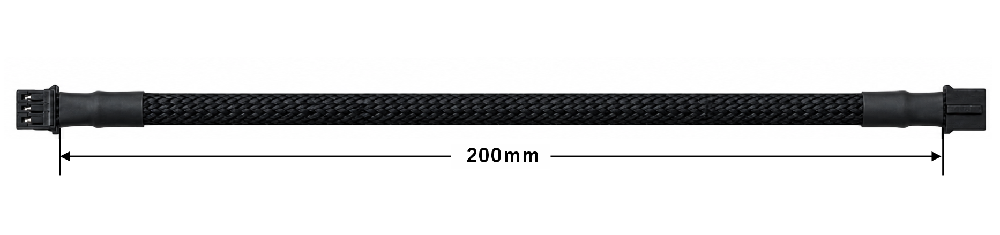
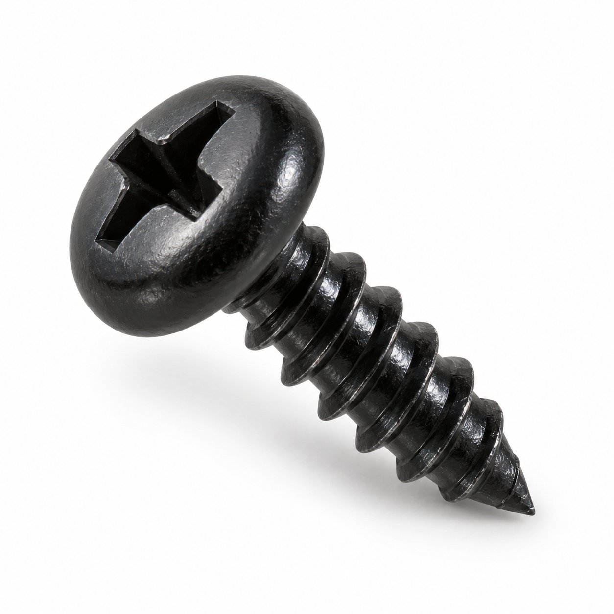

# Star Arm 102-LD 硬件

[← 硬件资源](../README.zh.md)　|　[English](README.md) / **简体中文**

  
  
  
  
  
  

**目录：**

- [📂 资源目录](#resources)
- [📋 物料清单](#bill-of-materials)

## 资源目录

| 目录 | 内容 | 状态 |
| --- | --- | --- |
| [DIY 装配](../../docs/diy-assembly/README.zh.md#102-ld) | 主体机械臂装配视频 | ✅ 已完成 |
| [step/](step/) | parts/ 零件模型；assembly/ 共用装配模型 | ✅ 已完成 |
| [printing/](printing/) | 3MF 打印项目；STL：[查看零件](printing/stl/) · [下载整套 ZIP](printing/star-arm-102-ld-stl.zip) | ✅ 已完成 |
| [drawings/](drawings/) | PDF／DWG 图纸 | ✅ 已完成 |
| [robot-description/](robot-description/) | URDF 模型：[浏览源码](robot-description/) · [下载 ZIP](robot-description/star-arm-102-ld-hd-urdf.zip) | ✅ 已完成 |

## 物料清单

下表列出 102-LD 的 **28 项装机物料**；无图片的条目标为待补。

打印件的“型号／规格”与 STEP、STL 及独立 3MF 的文件名主体一致（不含扩展名）。BOM 中的打印参数仅供参考，尚未完成实物打印验证。

紧固件图片为 AI 生成的外观示意图，规格以表格文字为准；点击图片可放大查看。

| 序号 | 品名 | 型号／规格 | 图片 | 描述 | 数量 |
| :---: | --- | --- | :---: | --- | :---: |
| 1 | UART 总线舵机 | RA8-U01H-M |  | 12V；双轴；无电机（无扭矩输出）；12 位磁性绝对值编码器；25T | 4 |
| 2 | UART 总线舵机 | RA8-U02H-M |  | 12V；双轴款壳体（平面下盖，无后输出轴）；无电机（无扭矩输出）；12 位磁性绝对值编码器；D 型轴 | 1 |
| 3 | UART 总线舵机 | RA8-U03H-M |  | 12V；双轴款壳体（平面下盖，无后输出轴）；无电机（无扭矩输出）；12 位磁性绝对值编码器；25T | 2 |
| 4 | 基座底板 | star-arm-102-base-bottom |  | 象牙白，PLA 3D 打印件；壁数：2；填充密度：15% | 1 |
| 5 | 基座顶板 | star-arm-102-base-top |  | 象牙白，PLA 3D 打印件；分区域参数，详见 3MF | 1 |
| 6 | 第一连杆 | star-arm-102-link1 |  | 象牙白，PLA 3D 打印件；壁数：5；填充密度：50% | 1 |
| 7 | 第二连杆 | star-arm-102-link2 |  | 象牙白，PLA 3D 打印件；壁数：2；填充密度：10% | 1 |
| 8 | 第三连杆 | star-arm-102-link3 |  | 象牙白＋黑色，PLA 3D 打印件；分区域参数，详见 3MF | 1 |
| 9 | 第四连杆 | star-arm-102-link4 |  | 象牙白，PLA 3D 打印件；壁数：2；填充密度：15% | 1 |
| 10 | 第五连杆 | star-arm-102-link5 |  | 象牙白，PLA 3D 打印件；壁数：2；填充密度：15% | 1 |
| 11 | 第六连杆（手柄端） | star-arm-102-link6-handle |  | 象牙白，PLA 3D 打印件；壁数：5；填充密度：15% | 1 |
| 12 | 手柄 | star-arm-102-handle |  | 象牙白，PLA 3D 打印件；壁数：2；填充密度：15% | 1 |
| 13 | 左指环 | star-arm-102-finger-ring-left |  | 象牙白，PLA 3D 打印件；壁数：2；填充密度：15% | 1 |
| 14 | 右指环 | star-arm-102-finger-ring-right |  | 象牙白，PLA 3D 打印件；壁数：2；填充密度：15% | 1 |
| 15 | 推力滚针轴承 | AXK2035+2AS |  | 内径 20 mm，外径 35 mm，厚度 4 mm | 1 |
| 16 | 电路板 | UC-01 |  | DC 电源线：0.75 mm²，5.5 × 2.1 mm 母头，0.15 m | 1 |
| 17 | 舵机连接线 | PH2.0 (PH-3Y) 120 mm |  | 黑色硅胶绝缘排线，外覆黑色编织护套；两端线序反向；每根导体 60 × Ø0.08 mm（约 22 AWG） | 5 |
| 18 | 舵机连接线 | PH2.0 (PH-3Y) 200 mm |  | 黑色硅胶绝缘排线，外覆黑色编织护套；两端线序反向；每根导体 60 × Ø0.08 mm（约 22 AWG） | 2 |
| 19 | 内六角圆柱头螺钉 | M3 × 22 |  | 黑色表面 | 4 |
| 20 | 内六角圆柱头螺钉 | M3 × 10 |  | 黑色表面，强度等级 12.9 | 1 |
| 21 | 内六角圆柱头螺钉 | M2 × 10 |  | 黑色表面 | 8 |
| 22 | 内六角圆柱头螺钉 | M2 × 8 |  | 黑色表面 | 16 |
| 23 | 十字槽沉头自攻螺钉 | 3 × 12 mm |  | 银色表面 | 2 |
| 24 | 十字槽盘头螺钉 | M3 × 10 |  | 黑色表面，加硬 | 1 |
| 25 | 十字槽盘头自攻螺钉 | PB2.0 × 5 |  | 黑色表面，加硬 | 39 |
| 26 | 十字槽盘头螺钉 | M2 × 4.5 |  | 黑色表面；靠近末端的约 2/3 螺纹段预涂蓝色锁固胶 | 35 |
| 27 | 螺母 | M3 |  | 黑色表面 | 5 |
| 28 | 垫片 | M3（3 × 6 × 0.5 mm） |  | 不锈钢 | 1 |

发现资料错误或需要帮助？请通过 [Support 支持中心](https://fashionstar.com.hk/support/) 联系我们，并注明型号及对应文件或条目。
