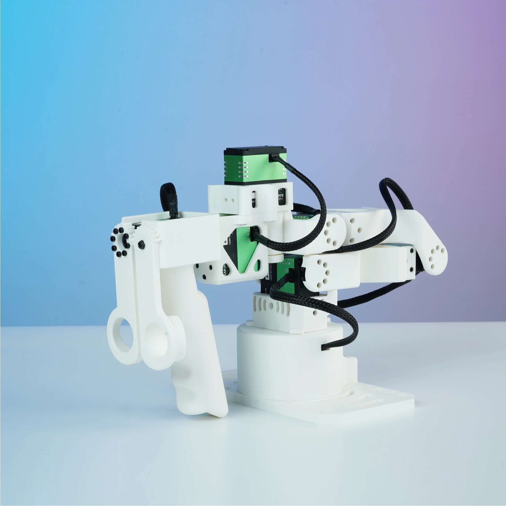
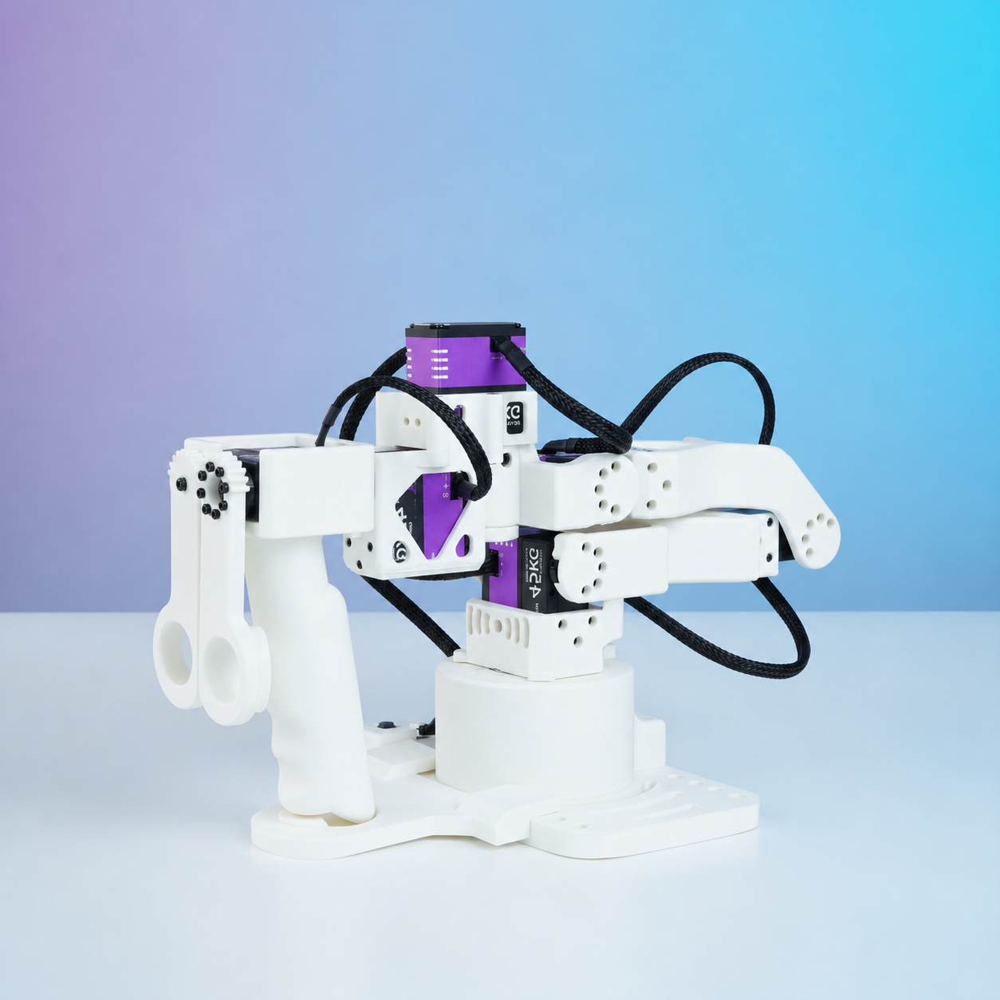
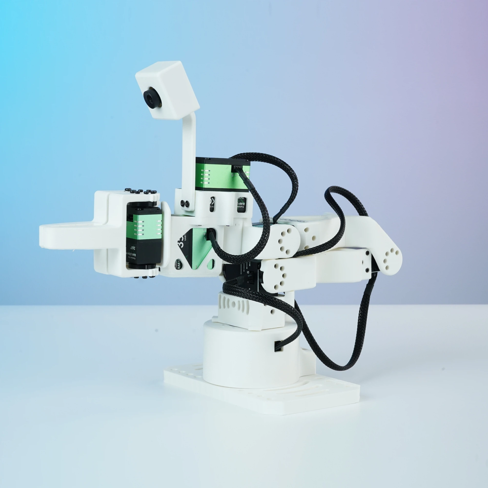

# Star Arm 102 Specifications & Hardware Resources

[← Home](../README.md)　|　<sub>**English** / [简体中文](README.zh.md)</sub>

**Contents:**

- [🔧 Specifications](#product-specifications)
- [🔢 Joint and servo ID mapping](../docs/specifications.md#joint-ids-and-names)
- [🛠️ DIY Assembly](../docs/diy-assembly/)
- [📂 Directory Structure](#directory-structure)

**Explore your model:**

<table width="100%">
<tr>
<td width="33%" align="center" valign="top">
<a href="102-ld/"><br><strong>Star Arm 102-LD</strong></a>
<br><sub>Leader arm</sub>
</td>
<td width="33%" align="center" valign="top">
<a href="102-hd/"><br><strong>Star Arm 102-HD</strong></a>
<br><sub>Pose-holding leader arm</sub>
</td>
<td width="33%" align="center" valign="top">
<a href="102-fl/"><br><strong>Star Arm 102-FL</strong></a>
<br><sub>Follower arm · optional camera shown</sub>
</td>
</tr>
</table>

Accessory files: **[Camera Module](camera-module/)** · **[Flexible Gripper](flexible-gripper/)**. BOMs: [Camera Module (Optional)](102-fl/README.md#camera-module-bom) · [Flexible Gripper](102-fl/README.md#flexible-gripper-bom).

<a id="product-specifications"></a>

## Specifications

| Specification | Star Arm 102-LD | Star Arm 102-HD | Star Arm 102-FL |
| --- | --- | --- | --- |
| Arm type | Leader Arm | Pose-holding Leader Arm | Follower Arm |
| Power | 12 V / 3 A | 12 V / 5 A | 12 V / 10 A |
| Reach | 420mm | 420mm | 420mm |
| DoF | 6+1 | 6+1 | 6+1 |
| Payload | — | — | 500g (70% reach recommended) |
| Repeatability / Encoder | 12-bit magnetic encoder | 12-bit magnetic encoder | 2mm |
| Joint Motion Range | Joint 1: ±110°<br>Joint 2: 0°–180°<br>Joint 3: 0°–270°<br>Joint 4: ±90°<br>Joint 5: ±65°<br>Joint 6: ±150°<br>Handle: 0°–90° | Joint 1: ±110°<br>Joint 2: 0°–180°<br>Joint 3: 0°–270°<br>Joint 4: ±90°<br>Joint 5: ±65°<br>Joint 6: ±150°<br>Handle: 0°–90° | Joint 1: ±110°<br>Joint 2: 0°–180°<br>Joint 3: 0°–270°<br>Joint 4: ±90°<br>Joint 5: ±65°<br>Joint 6: ±150°<br>Gripper: 0°–90° |
| Servos | RA8-U01H-M × 4<br>RA8-U02H-M × 1<br>RA8-U03H-M × 2 | RP8-U45H-M × 4<br>RP8-U45H-M-C029 × 1<br>RP8-U45H-M-C028 × 2 | RA8-U35H-M × 3<br>RX8-U48H-M × 2<br>RA8-U27H-M-C005 × 1<br>RA8-U35H-M-C047 × 1 |
| Arm weight | 764g | 934g | 865g |
| Communication | UART / UC-01 | UART / UC-01 | UART / UC-01 |
| Operating Temperature | 0–40°C | 0–40°C | 0–40°C |

Joints 1–6 (J1–J6) above map to servo IDs 0–5; the handle/gripper maps to ID 6. The HD button board uses ID 7. [Joint and servo ID mapping](../docs/specifications.md#joint-ids-and-names).

<a id="directory-structure"></a>

## Directory structure

All three models share the same layout: whole-arm STEP assemblies are stored directly in step/; 3mf/ contains 3D printing files. The [102-FL 3MF file](102-fl/3mf/) is available; LD and HD files are coming soon. The LD layout is expanded below. Each model README contains its own BOM.

Accessory directories contain only `step/`, `3mf/` and `drawings/`; 3MF files are not yet available. Flexible-gripper and camera-module BOMs are maintained on the 102-FL page.

```text
hardware/
├── README.md
├── README.zh.md
├── 102-ld/
│   ├── README.md
│   ├── README.zh.md
│   ├── step/
│   │   └── star-arm-102-ld-assembly-export-2026-11-01.step
│   ├── 3mf/
│   ├── drawings/
│   └── urdf/
│       ├── downloads/
│       │   └── star-arm-102-ld-hd-urdf-2026-10-21.zip
│       └── stararm102-ld-hd-description/
├── 102-hd/
├── 102-fl/
├── camera-module/
│   ├── step/
│   ├── 3mf/
│   └── drawings/
└── flexible-gripper/
    ├── step/
    ├── 3mf/
    └── drawings/
```

`step/` contains CAD assemblies; assembly, PID setup and zero calibration are covered in the [DIY assembly guide](../docs/diy-assembly/README.md). Each model provides its ROS 1 source package and complete ZIP: [LD](102-ld/urdf/), [HD](102-hd/urdf/), [FL](102-fl/urdf/). LD and HD contain the same model.

## Licensing

Hardware licensing remains unresolved; see [license scope](../LICENSE.md). No new license is granted by copying or renaming files.
