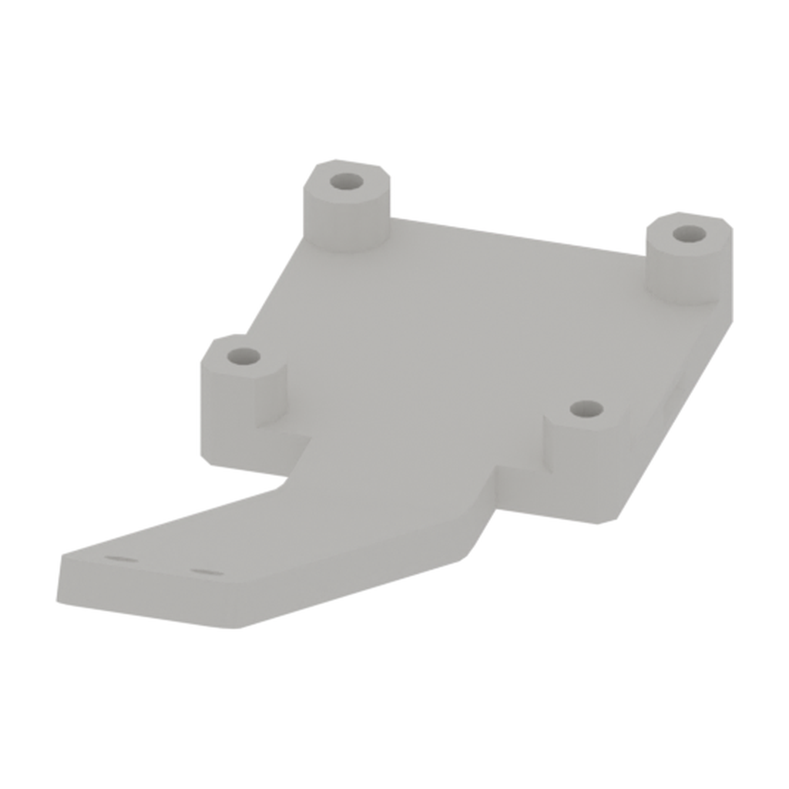
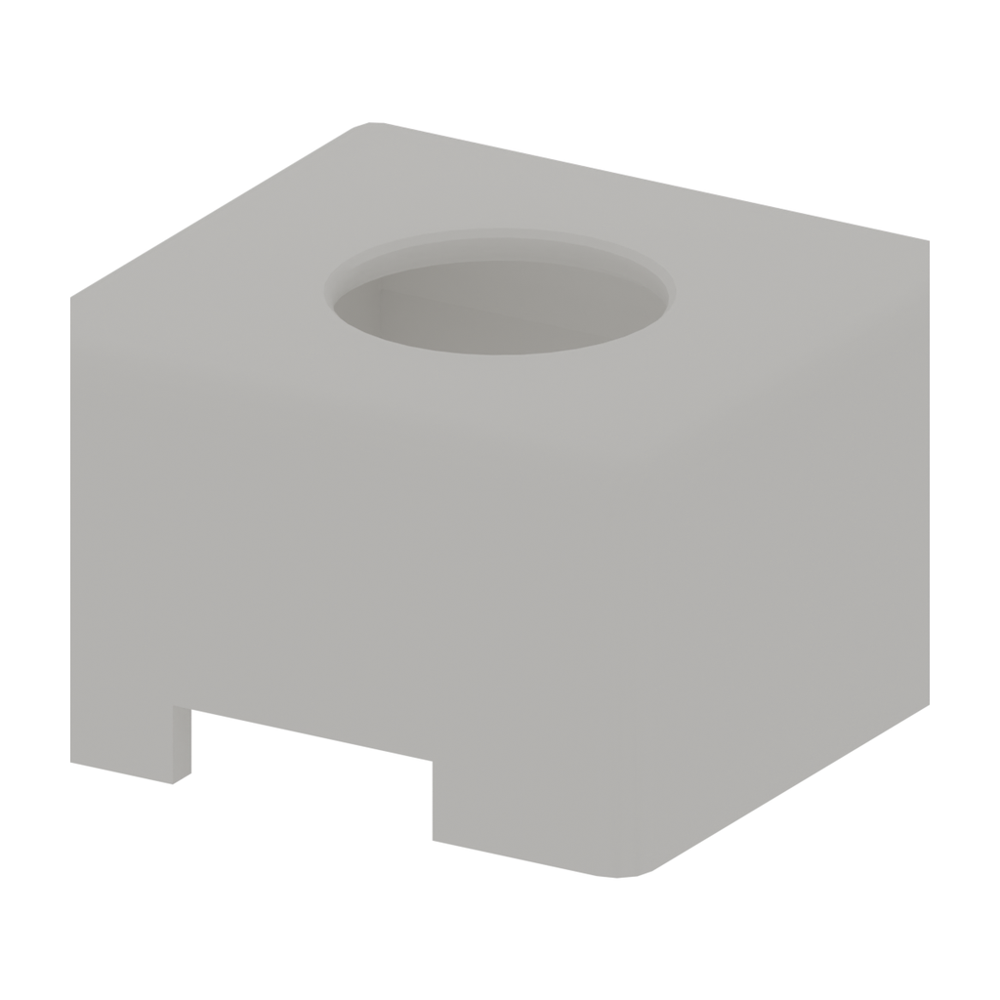
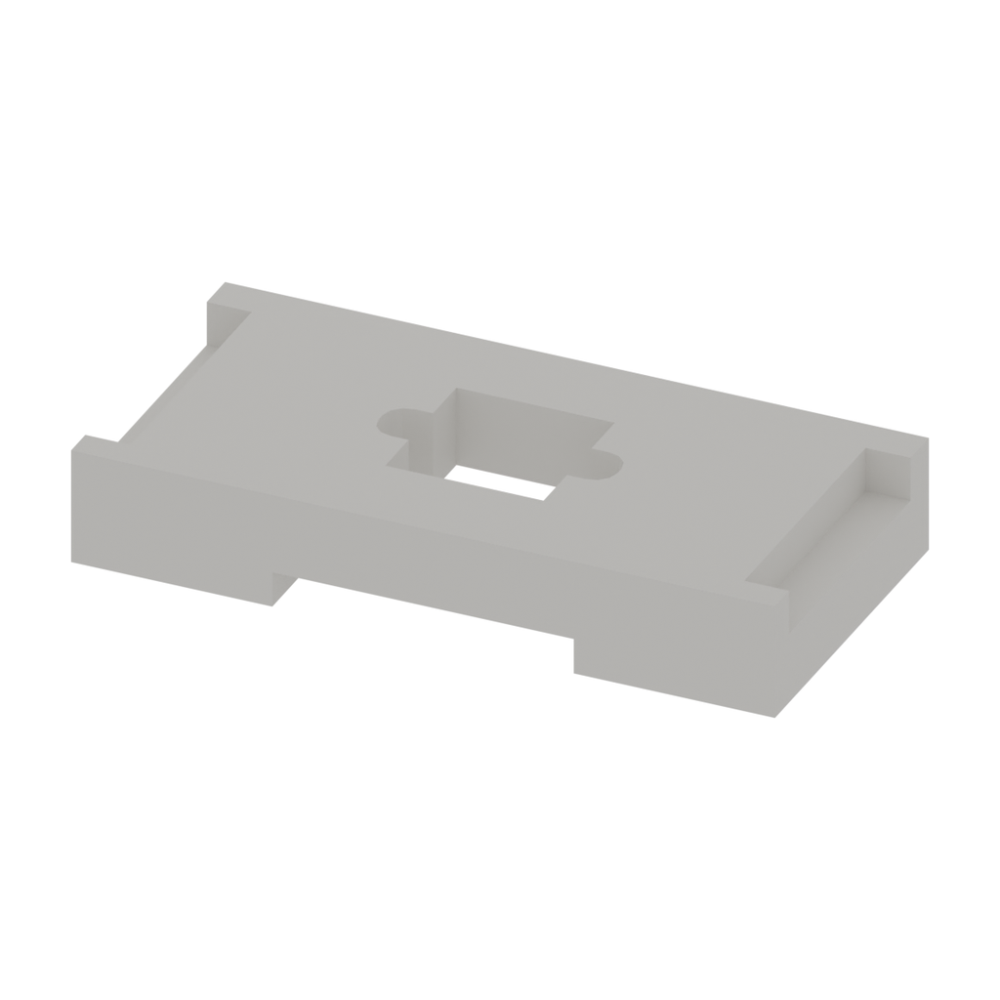

# Camera Module hardware

[← Hardware Resources](../README.md)　|　**English** / [简体中文](README.zh.md)

**Contents:**

- [📂 Resources](#resources)
- [📋 Bill of Materials](#bill-of-materials)

## Resources

| Directory | Description | Status |
| --- | --- | --- |
| [Assembly guide](../../docs/diy-assembly/README.md#camera-module-assembly) | Assembly and installation video | — Video coming soon |
| [step/](step/) | Part models in parts/; assemblies in assembly/ | ✅ 3 part models and 1 assembly available |
| [stl/](stl/) | [Download all STL files (3 parts)](stl/downloads/camera-module-stl-2026-10-23.zip?raw=true) · [Browse individual STL files](stl/) | ✅ Available |
| [drawings/](drawings/) | PDF / DWG drawings | — To be added |
| [robot-description/](robot-description/) | URDF and meshes | — To be added |

## Bill of Materials

The table lists **3 parts** with supplied STEP models. Names match the filenames. Materials, quantities per set, and print settings await confirmation. Purchased items such as cameras, servos, and fasteners are not yet listed; this is not a complete purchasing BOM.

| No. | Name | Image | Description | Quantity | Notes |
| :---: | --- | :---: | --- | :---: | --- |
| 1 | first-person-camera-base-snap-fit |  | Material to be confirmed | To be confirmed | Snap-fit camera base above the gripper |
| 2 | first-person-camera-cover-snap-fit |  | Material to be confirmed | To be confirmed | Snap-fit camera cover above the gripper |
| 3 | third-person-camera |  | Material to be confirmed | To be confirmed | Camera model for the desktop stand |

Found an error in these resources or need help? Contact our [Support Hub](https://fashionstar.com.hk/support/) with your product and the relevant file or item.
