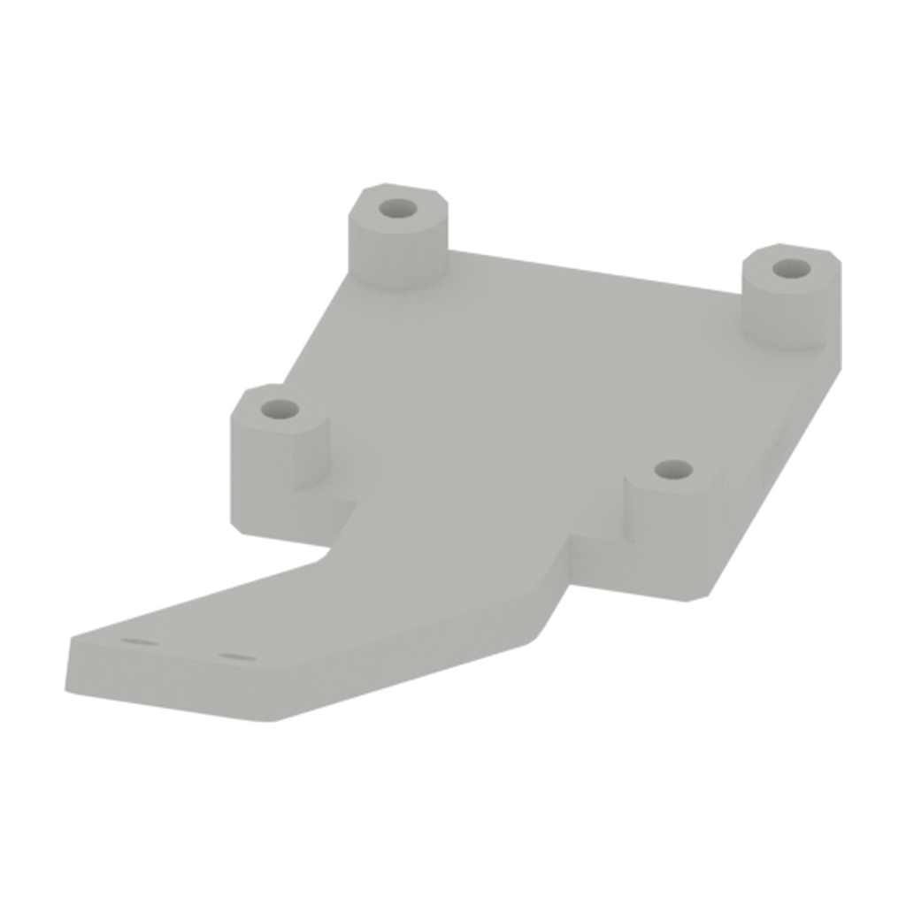
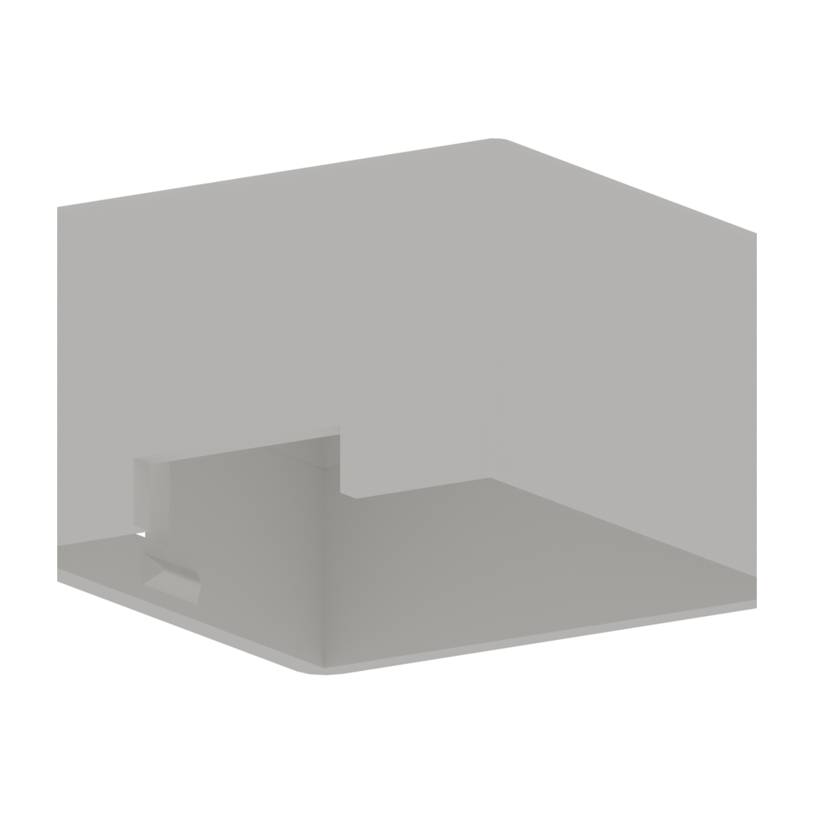
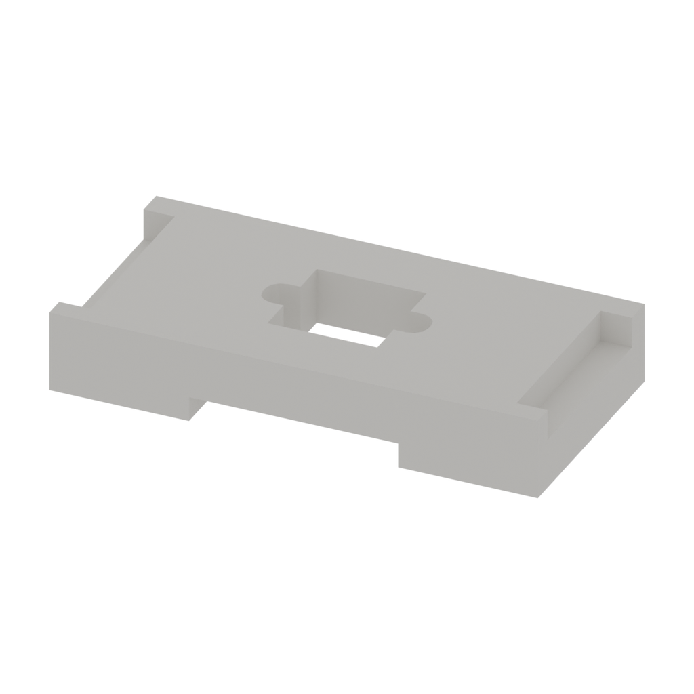

# 摄像头模组硬件资源

[← 硬件资源](../README.zh.md)　|　[English](README.md) / **简体中文**

**目录：**

- [📂 资源目录](#resources)
- [📋 物料清单](#bill-of-materials)

## 资源目录

| 目录 | 内容 | 状态 |
| --- | --- | --- |
| [装配指南](../../docs/diy-assembly/README.zh.md#camera-module-assembly) | 装配与安装视频 | — 视频待上线 |
| [step/](step/) | parts/ 零件模型；assembly/ 装配模型 | ✅ 已提供 3 个零件模型与 1 个装配体 |
| [stl/](stl/) | [下载整套 STL（3 个打印件）](stl/downloads/camera-module-stl-2026-10-23.zip?raw=true) · [浏览单个 STL](stl/) | ✅ 已提供 |
| [drawings/](drawings/) | PDF／DWG 图纸 | — 待提供 |

## 物料清单

下表列出已提供 STEP 模型的 **3 个零件**。每套各需 1 件。打印参数待确认；摄像头、舵机、紧固件等外购件尚未列入，当前并非完整采购清单。

| 序号 | 品名 | 型号／规格／零件标识 | 图片 | 描述 | 数量 |
| :---: | --- | --- | :---: | --- | :---: |
| 1 | 第一视角摄像头底座（卡扣式） | first-person-camera-base-snap-fit |  | 象牙白，PLA 3D 打印件；夹爪上方摄像头卡扣底座 | 1 |
| 2 | 第一视角摄像头盖（卡扣式） | first-person-camera-cover-snap-fit |  | 象牙白，PLA 3D 打印件；夹爪上方摄像头卡扣盖 | 1 |
| 3 | 第三视角摄像头底座 | third-person-camera-base |  | 象牙白，PLA 3D 打印件；桌面支架位置的摄像头底座 | 1 |

发现资料错误或需要帮助？请通过 [Support 支持中心](https://fashionstar.com.hk/support/) 联系我们，并注明产品及对应文件或条目。
