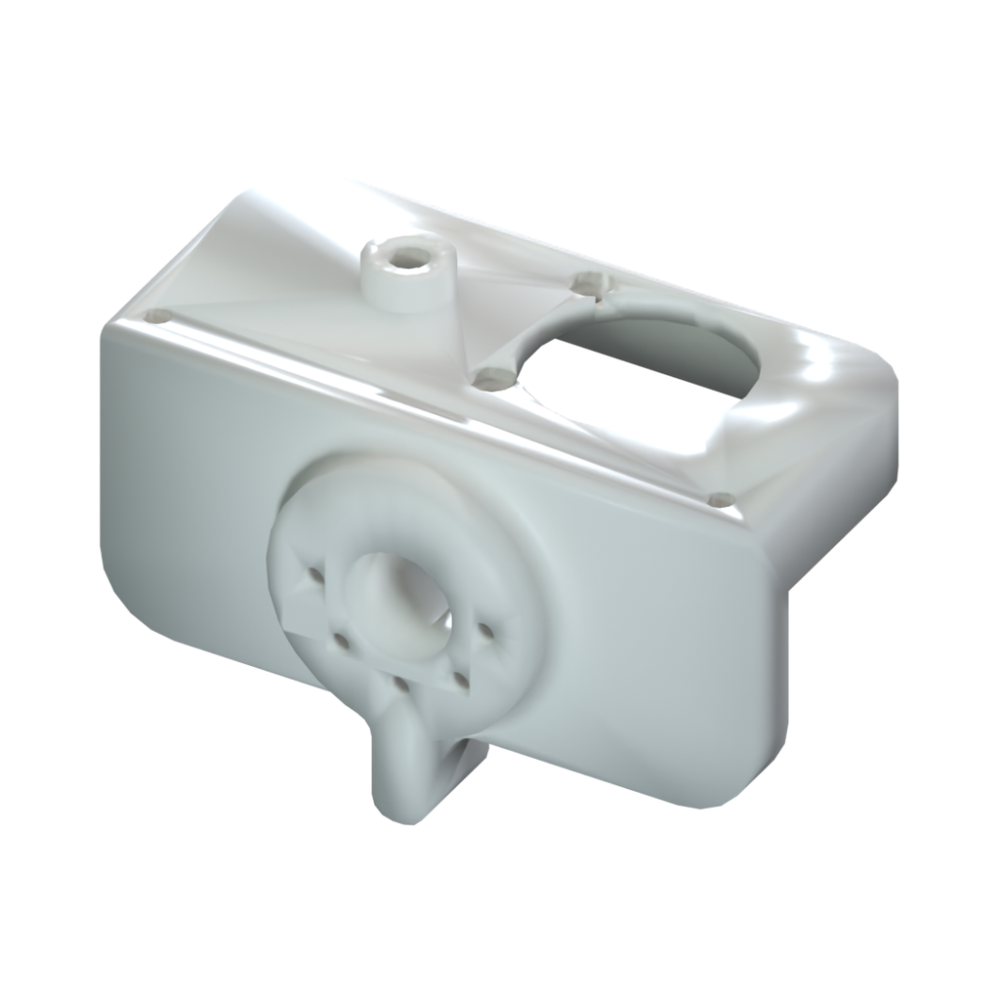
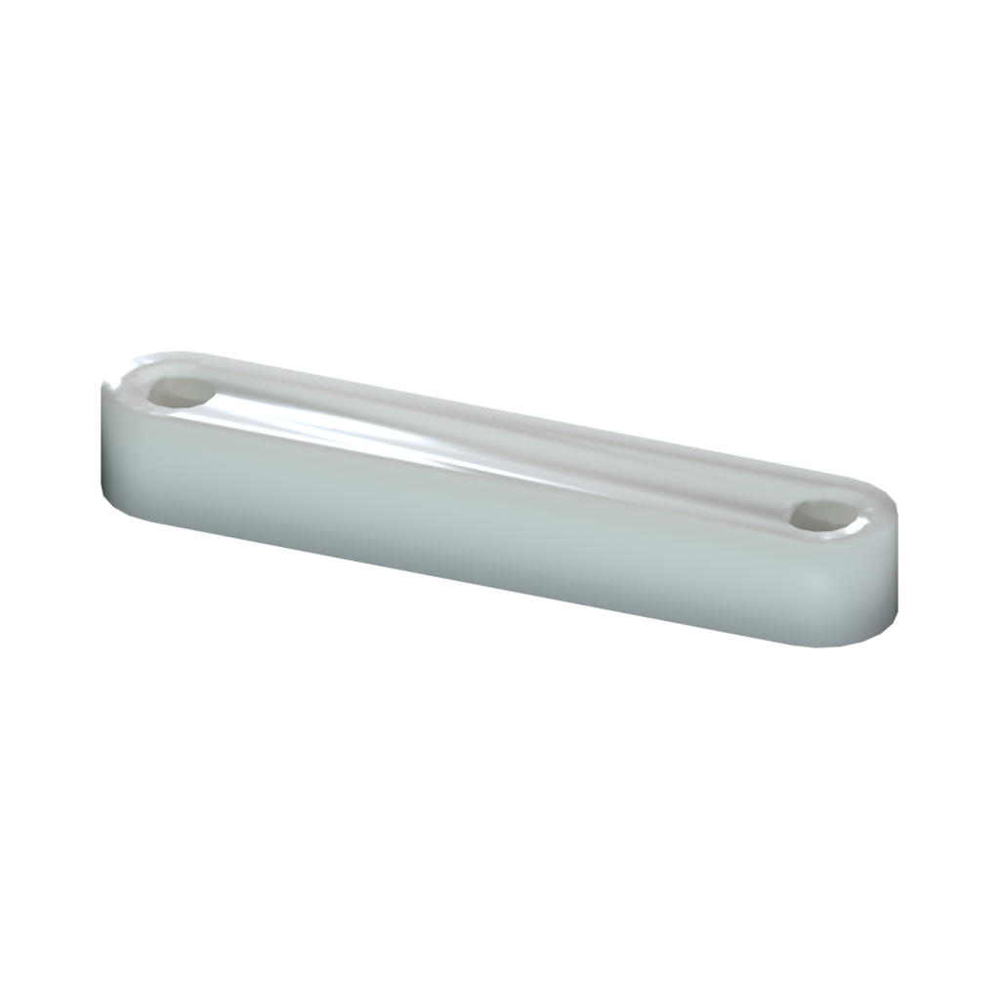
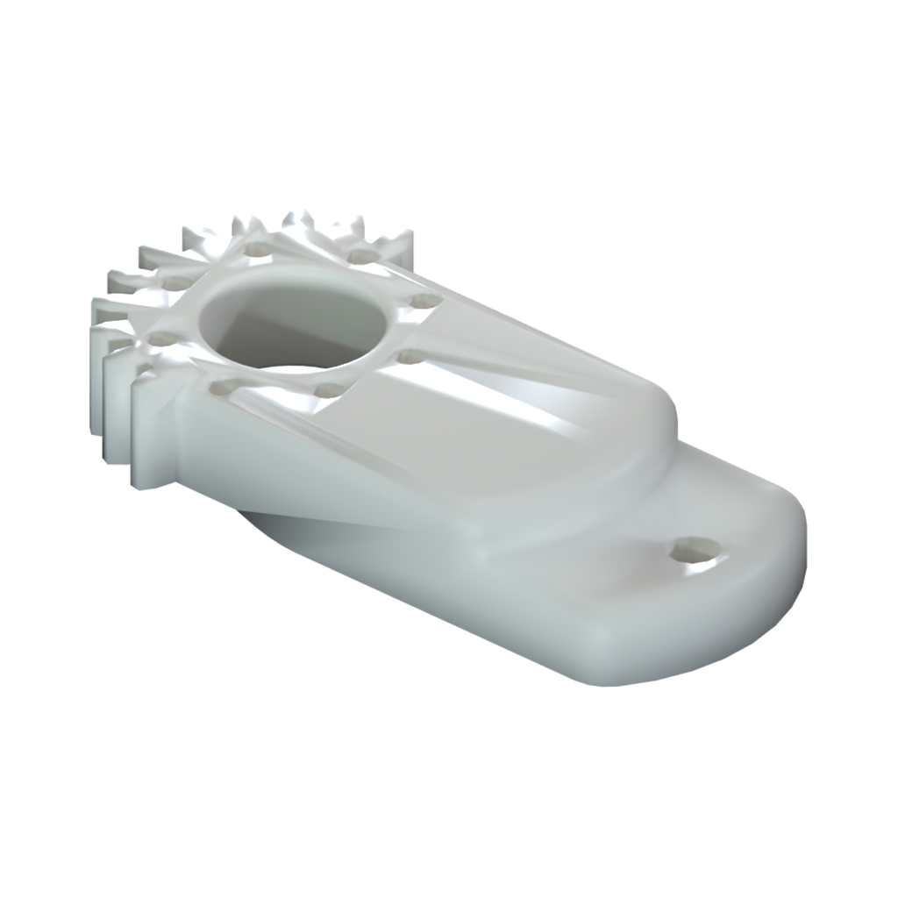
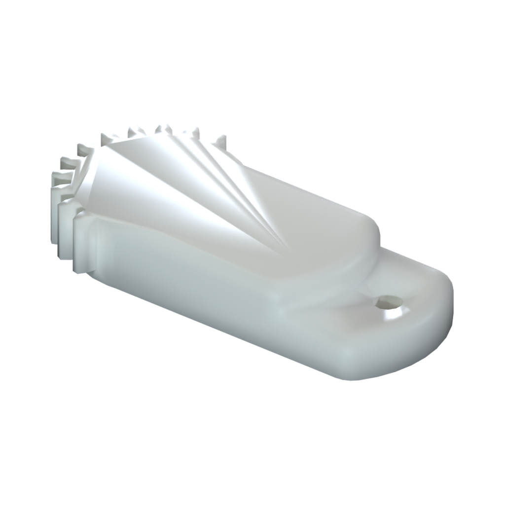
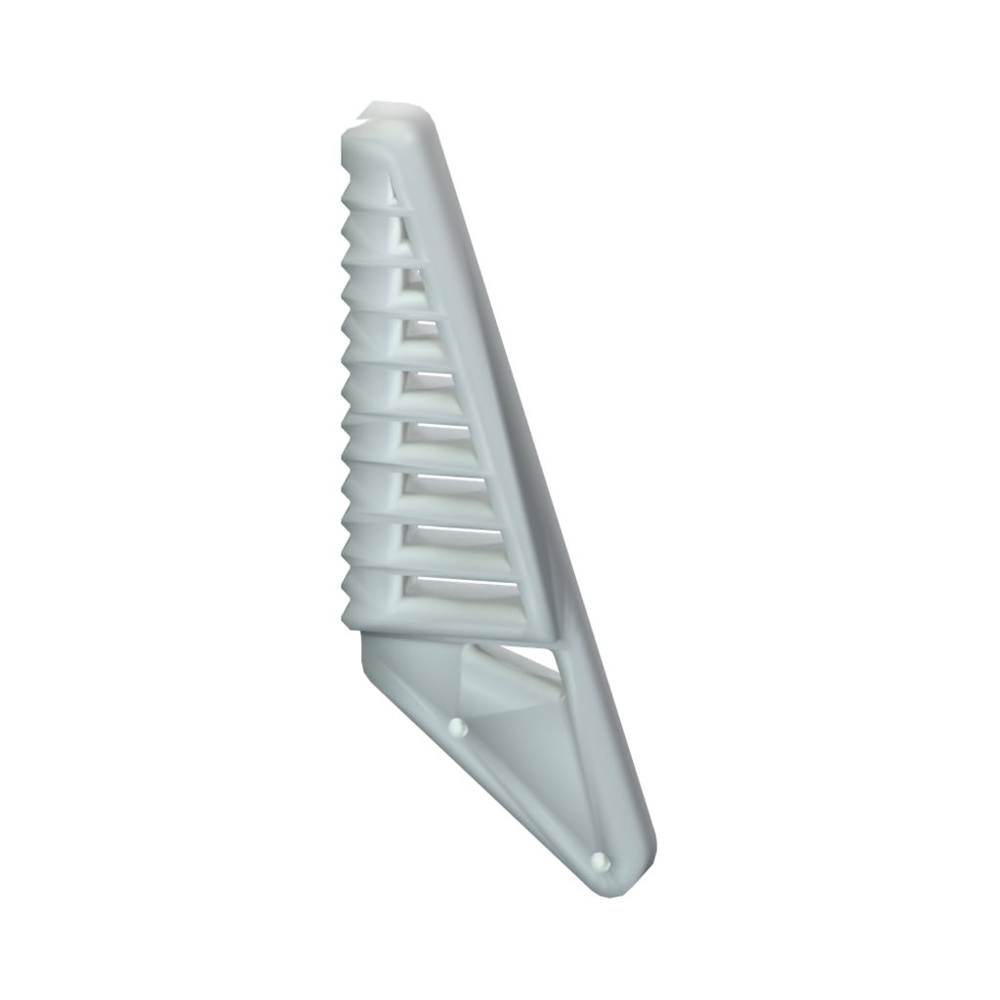
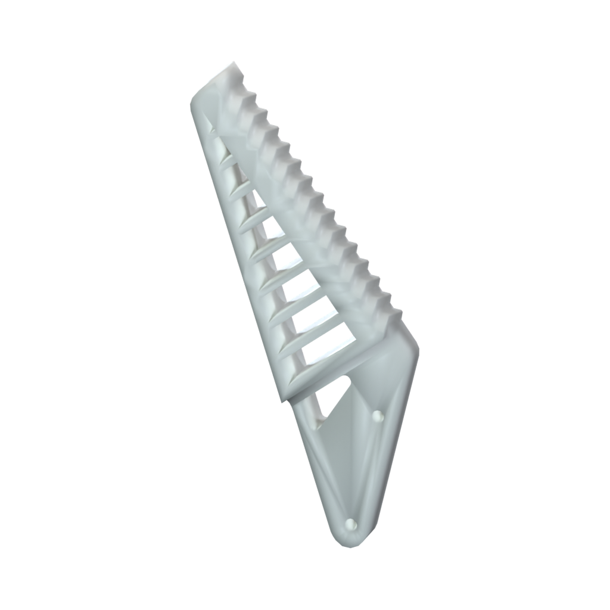

# 柔性夹爪硬件资源

[← 硬件资源](../README.zh.md)　|　[English](README.md) / **简体中文**

**目录：**

- [📂 资源目录](#resources)
- [📋 物料清单](#bill-of-materials)

## 资源目录

| 目录 | 内容 | 状态 |
| --- | --- | --- |
| [装配指南](../../docs/diy-assembly/README.zh.md#flexible-gripper-assembly) | 装配与安装视频 | ✅ 视频已提供 |
| [step/](step/) | parts/ 零件模型；assembly/ 装配模型 | ✅ 已提供 6 个零件模型及 1 个装配模型 |
| [stl/](stl/) | 独立 STL 打印文件 | ✅ 已提供 |
| [drawings/](drawings/) | PDF／DWG 图纸 | — 待提供 |
| [robot-description/](robot-description/) | URDF 和网格 | — 待提供 |

## 物料清单

下表列出已提供 STEP 模型的 **6 个零件**，名称与文件名一致。材料、每套用量及打印参数待确认；摄像头、舵机、紧固件等外购件尚未列入，当前并非完整采购清单。

整体装配模型位于 [step/assembly/](step/assembly/)，用于查看装配关系，不作为额外零件重复计入 BOM。

| 序号 | 名称 | 图片 | 描述 | 数量 | 备注 |
| :---: | --- | :---: | --- | :---: | --- |
| 1 | dual-shaft-flexible-gripper-body |  | 材料待确认 | 待确认 | 双轴柔性夹爪主体 |
| 2 | flexible-gripper-link |  | 材料待确认 | 待确认 | 夹爪连杆 |
| 3 | flexible-gripper-1 |  | 材料待确认 | 待确认 | 夹爪零件 1 |
| 4 | flexible-gripper-2 |  | 材料待确认 | 待确认 | 夹爪零件 2 |
| 5 | flexible-gripper-fingertip-1 |  | 材料待确认 | 待确认 | 指尖零件 1 |
| 6 | flexible-gripper-fingertip-2 |  | 材料待确认 | 待确认 | 指尖零件 2 |

发现资料错误或需要帮助？请通过 [Support 支持中心](https://fashionstar.com.hk/support/) 联系我们，并注明产品及对应文件或条目。
