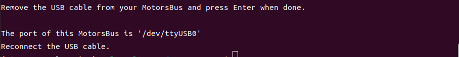
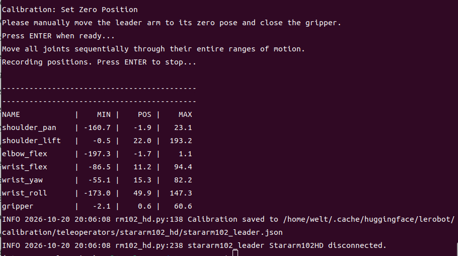
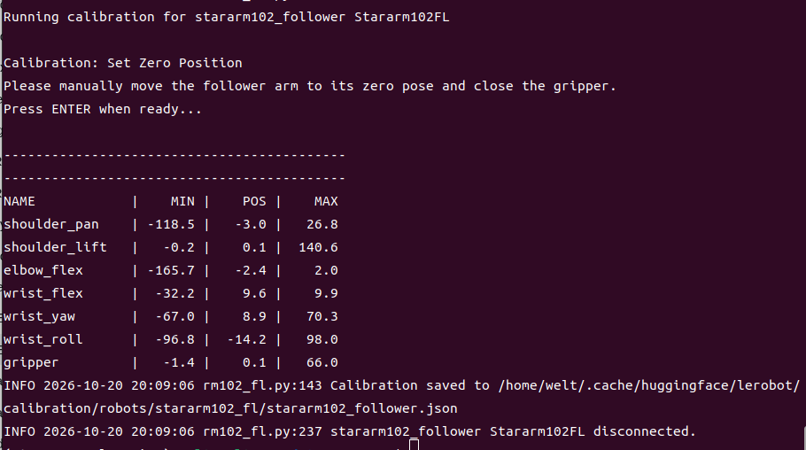
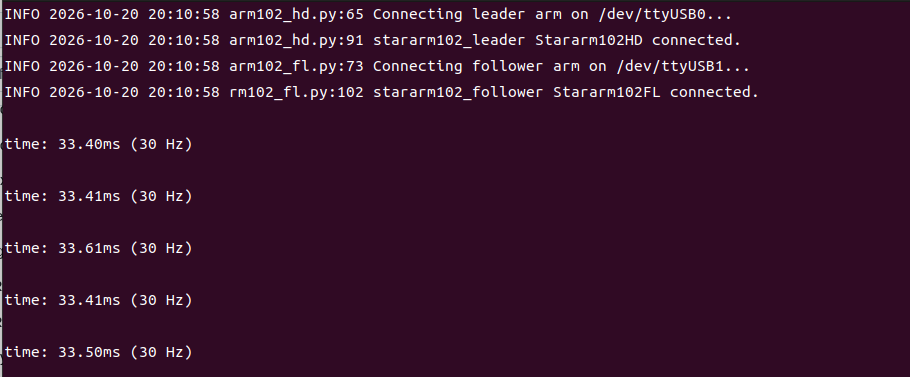
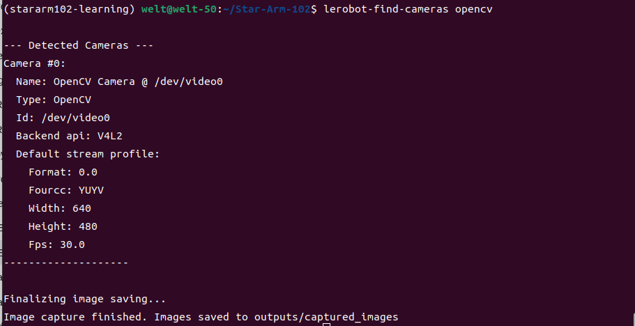
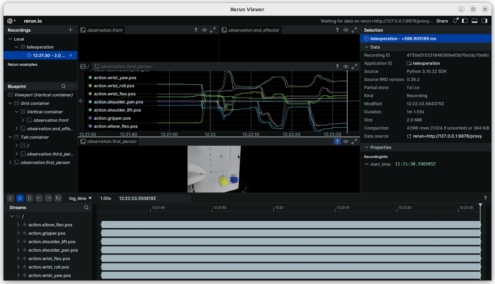

# LeRobot on Star Arm 102

[← Home](../README.md)　|　<sub>**English** / [简体中文](README.zh.md)</sub>

Teleoperate a 102-FL with a 102-LD or 102-HD, collect demonstrations, and train and evaluate your own ACT policy. Choose your starting point:

| Your goal | Start here |
| --- | --- |
| Record demonstrations and train my own task | Follow the tutorial below using the refactored integration |
| Control two independent leader–follower pairs | [Dual-pair LeRobot plugin](dual-arm/) |
| Try a supplied AI model without training | [Pretrained ACT block-placement demo](examples/act_pick/README.md), with its own release-compatible environment |
| Control another brand of follower | [Follower compatibility and pairing guides](../integrations/README.md) |

**Two environments:** this tutorial uses `stararm102_hd` / `stararm102_fl` and named joints. The supplied ACT model uses the 0.0.1 plugins and `Motor_0`…`Motor_5`. Their leader packages share an installation name: use separate environments and do not exchange calibration files, datasets, or model inputs. See [version compatibility](../docs/compatibility.md).

**Validation:** package installation and CLI discovery have been checked. End-to-end calibration, motion, recording, training, and evaluation on LD/HD/FL still require bench validation. Commands below are a version-specific starting workflow, not a claimed tested training recipe. [Validation record](../docs/validation.md).

**Contents:**

- [📋 Before you start](#before-you-start)
- [📦 Install the environment](#install)
- [🔌 Identify arms and ports](#ports)
- [🎯 LeRobot calibration](#calibration)
- [🎮 First teleoperation](#teleoperation)
- [📷 Add cameras](#cameras)
- [🔴 Record and inspect demonstrations](#record)
- [🔁 Review and replay an episode](#replay)
- [🧠 Train ACT](#train)
- [🤖 Run and evaluate your policy](#evaluate)
- [🛠️ Troubleshooting](#troubleshooting)

<a id="before-you-start"></a>

## 1. Before you start

Prepare one 102-LD or 102-HD leader, one 102-FL follower, matching supplies and USB data cables. Start on Ubuntu 22.04 with Python 3.10. Cameras are added after basic teleoperation; this tutorial's ACT training uses an NVIDIA CUDA GPU.

Fully assembled and configured arms can start here. For DIY builds or replaced servos, complete [DIY assembly, hardware zero calibration, and PID configuration](../docs/diy-assembly/README.md) first. Follow [Get Started](../docs/getting-started.md#connect) for power, USB wiring, and communication checks.

| Hardware | Software role | Button setting |
| --- | --- | --- |
| 102-LD | `stararm102_hd` teleoperator, despite the software name | `false`; no motorized pose holding |
| 102-HD | `stararm102_hd` teleoperator | Start with `false`; enable only after checking the ID 7 button board |
| 102-FL | `stararm102_fl` robot | No leader button configuration |

Secure both bases and support the arms when torque is disabled. Connecting this integration can unlock joints and reset multi-turn counts. Use the matching reference pose before reconnecting. `Ctrl+C` requests program exit; it is not a hardware emergency stop. [Reference pose and stopping](../docs/getting-started.md#reference-pose-and-stopping).

<a id="install"></a>

## 2. Install the environment

With [Miniforge](https://github.com/conda-forge/miniforge#install) installed, open a terminal at the **Star-Arm-102 repository root**. Keep that working directory throughout the tutorial.

```bash
conda create -n stararm102-learning python=3.10 -y
conda activate stararm102-learning
conda install -c conda-forge ffmpeg -y
python -m pip install "lerobot==0.4.1" "lerobot-motor-starai==0.0.6" "fashionstar-uart-sdk==1.3.12"
python -m pip install ./lerobot/single-arm/lerobot-stararm102
python -m pip check
python -c "from lerobot_teleoperator_stararm102 import Stararm102HD, Stararm102FL; print('HD/FL imports OK')"
lerobot-teleoperate --help
```

Use a regular installation: editable installation was not discovered reliably by LeRobot 0.4.1. Reinstall the local package after source changes. Do not install the 0.0.1 leader plugin in this environment. Select a GPU-compatible PyTorch build using the [PyTorch installation guide](https://pytorch.org/get-started/locally/), then check:

```bash
python -c "import torch; print(torch.__version__); print('CUDA:', torch.cuda.is_available())"
python -m pip check
python -m pip freeze > stararm102-learning-environment.txt
git rev-parse HEAD
```

**Success:** imports work, `pip check` passes, and CLI help lists `stararm102_hd` and `stararm102_fl`. CUDA must be available before the GPU training step; basic teleoperation does not require a GPU. Save the environment file and repository commit with your dataset.

<a id="ports"></a>

## 3. Identify arms and ports

Run the port finder and follow its unplug/replug instructions for one USB adapter at a time. Label the leader and follower cables; port numbers may change after reconnection.

```bash
lerobot-find-port
```



Example: the tool identifies a USB adapter at `/dev/ttyUSB0`; use the port reported for your own arm.

Set these values once in the terminal. Replace both port paths with your results. The IDs are **calibration names**, not the servo bus IDs. Reuse them for the same physical arms. A new terminal needs the environment activated and these variables set again.

```bash
export STARARM_LEADER_PORT=/dev/ttyUSB0
export STARARM_FOLLOWER_PORT=/dev/ttyUSB1
export STARARM_LEADER_ID=stararm102_leader
export STARARM_FOLLOWER_ID=stararm102_follower
export STARARM_BUTTON=false
```

See the [full mapping](../docs/specifications.md#joint-ids-and-names) for joint numbers, servo bus IDs and LeRobot fields. `STARARM_LEADER_ID` / `STARARM_FOLLOWER_ID` are calibration names; they do not change servo IDs.

Confirm IDs 0–6 respond using the [communication check](../python-sdk/README.md#check-communication-without-commanding-motion), then close that process and other serial tools. If access is denied, check serial-device group permissions. Do not open the same port in multiple applications.

<a id="calibration"></a>

## 4. LeRobot calibration

Hardware zero calibration, PID configuration, and LeRobot calibration serve different purposes. Completing DIY configuration does not automatically create a LeRobot calibration file. This plugin also writes servo origin information during calibration; use the correct physical reference pose, not an arbitrary pose.

Revision-specific LD/HD/FL reference-pose photos still need confirmation. If your supplied instructions do not establish the pose, confirm it with [support](https://fashionstar.com.hk/support/) before running calibration; do not substitute Cello/Violin images.

```bash
lerobot-calibrate \
  --teleop.type=stararm102_hd \
  --teleop.port="$STARARM_LEADER_PORT" \
  --teleop.id="$STARARM_LEADER_ID" \
  --teleop.button.enabled=false

lerobot-calibrate \
  --robot.type=stararm102_fl \
  --robot.port="$STARARM_FOLLOWER_PORT" \
  --robot.id="$STARARM_FOLLOWER_ID"
```



Leader example: the terminal lists the recorded joint ranges and saved calibration file.



Follower example: the terminal lists its own joint ranges and saved calibration file. Actual results depend on the physical arms; these screenshots are for reference only.

1. Support the arm while the program unlocks it. At the prompt, place it in the confirmed zero pose and close the gripper/leader handle as instructed.
2. Confirm the pose, then record each joint's available motion range, including the gripper. Do not force mechanical stops.
3. Save the calibration and note the path printed by the program. Repeat for the other arm.

If a calibration exists, follow the prompt to reuse it or enter `c` to recalibrate. Keep files with the same physical arm, ID, and plugin. Configured `joint_directions` and `joint_ranges` still affect motion: recalibration alone does not correct a wrong direction or limit.

**Success:** both calibrations are saved, all seven channels have meaningful ranges, and the following small-motion check passes.

<a id="teleoperation"></a>

## 5. First teleoperation

```bash
lerobot-teleoperate \
  --teleop.type=stararm102_hd \
  --teleop.port="$STARARM_LEADER_PORT" \
  --teleop.id="$STARARM_LEADER_ID" \
  --teleop.button.enabled="$STARARM_BUTTON" \
  --robot.type=stararm102_fl \
  --robot.port="$STARARM_FOLLOWER_PORT" \
  --robot.id="$STARARM_FOLLOWER_ID" \
  --fps=30
```



Example: the terminal reports both arms connected and displays the running loop rate.

Move one joint slowly through a small range and check the follower direction; then check all other joints and the gripper. Stop if there is a jump, reversed movement, or unexpected limit. Only proceed to coordinated movements once each joint behaves correctly.

**HD button:** after verifying the ID 7 board and lock/unlock behavior, set the variable below and rerun teleoperation. The implementation reads angles near 0° as unlocked and near 180° as locked; by default it freezes outgoing action while locked. This is pose holding, not an emergency stop. LD must keep `false`.

```bash
export STARARM_BUTTON=true
```

**Success:** seven channels follow in the intended direction; HD button behavior, when enabled, matches the expected lock state.

<a id="cameras"></a>

## 6. Add cameras

```bash
lerobot-find-cameras opencv
```



Example: the tool reports a camera at `/dev/video0` and saves a preview image; use your own detected device and preview.

Review the saved preview images to identify the actual capture devices. This new-task example uses `first_person` for the wrist view and `third_person` for the external view, both at 640 × 480 and 30 FPS. Replace indices 0 and 2. Camera names and views must stay consistent from recording through inference.

```bash
export STARARM_CAMERAS='{first_person: {type: opencv, index_or_path: 0, width: 640, height: 480, fps: 30}, third_person: {type: opencv, index_or_path: 2, width: 640, height: 480, fps: 30}}'

lerobot-teleoperate \
  --teleop.type=stararm102_hd \
  --teleop.port="$STARARM_LEADER_PORT" \
  --teleop.id="$STARARM_LEADER_ID" \
  --teleop.button.enabled="$STARARM_BUTTON" \
  --robot.type=stararm102_fl \
  --robot.port="$STARARM_FOLLOWER_PORT" \
  --robot.id="$STARARM_FOLLOWER_ID" \
  --robot.cameras="$STARARM_CAMERAS" \
  --fps=30 \
  --display_data=true
```



Example: the viewer shows a camera preview and joint action curves during teleoperation.

**Success:** both live views are correctly assigned, stable, and show the object and placement area during movement. Fix camera mounts, exposure, and orientation before collection. The supplied ACT model instead requires `up` and `front` with its documented scene; do not substitute these new-task camera names.

<a id="record"></a>

## 7. Record and inspect demonstrations

Choose one clear task, for example placing a block in the center of a marked area. First record two short episodes to check the pipeline; two episodes are not a sufficient training dataset. Use a new dataset name and directory for a new task.

```bash
export STARARM_DATASET_ID=customer/stararm102_block_demo
export STARARM_DATASET_ROOT="$PWD/outputs/stararm102_block_demo"

lerobot-record \
  --robot.type=stararm102_fl \
  --robot.port="$STARARM_FOLLOWER_PORT" \
  --robot.id="$STARARM_FOLLOWER_ID" \
  --robot.cameras="$STARARM_CAMERAS" \
  --teleop.type=stararm102_hd \
  --teleop.port="$STARARM_LEADER_PORT" \
  --teleop.id="$STARARM_LEADER_ID" \
  --teleop.button.enabled="$STARARM_BUTTON" \
  --dataset.repo_id="$STARARM_DATASET_ID" \
  --dataset.root="$STARARM_DATASET_ROOT" \
  --dataset.single_task="Place the block in the center" \
  --dataset.fps=30 \
  --dataset.num_episodes=2 \
  --dataset.episode_time_s=30 \
  --dataset.reset_time_s=10 \
  --dataset.push_to_hub=false \
  --display_data=true
```

| Setting | Meaning |
| --- | --- |
| `repo_id` / `root` | Dataset identifier and local storage path; this command does not upload to the Hub |
| `single_task` | A consistent description of the demonstrated task |
| `num_episodes` | Number of episodes to collect in this run |
| `episode_time_s` / `reset_time_s` | Recording time / scene-reset interval; control can remain active during reset |
| `--resume=true` | Add this to the same recording command to append to an existing compatible dataset |

During recording, with a working desktop keyboard listener, Right Arrow ends the current interval, Left Arrow requests a re-record, and Escape stops recording. Follow the terminal phase prompts before resetting the scene. Keyboard controls may be unavailable in a headless session; they are not hardware stops.

Wait for encoding and saving to finish. Keep `meta/`, `data/`, and `videos/` together. Before adding more demonstrations, use the next section to inspect both camera views, the seven state/action channels, timing, and task completion. Re-record missed grasps, occlusions, jumps, or unintended pauses. Collect variation in object positions deliberately, while keeping the task and camera setup consistent.

<a id="replay"></a>

## 8. Review and replay an episode

**Review on screen, without moving the arm:** open episode 0 in the dataset viewer. This command does not connect to a robot.

```bash
lerobot-dataset-viz \
  --repo-id "$STARARM_DATASET_ID" \
  --root "$STARARM_DATASET_ROOT" \
  --episode-index 0
```

**Replay on the physical follower:** only after reviewing the data, confirming the same plugin/calibration, and preparing the recorded start pose and workspace. This sends recorded actions and can move the arm immediately; it is not model inference and does not adapt to moved objects.

```bash
lerobot-replay \
  --robot.type=stararm102_fl \
  --robot.port="$STARARM_FOLLOWER_PORT" \
  --robot.id="$STARARM_FOLLOWER_ID" \
  --dataset.repo_id="$STARARM_DATASET_ID" \
  --dataset.root="$STARARM_DATASET_ROOT" \
  --dataset.episode=0
```

**Success:** screen review shows aligned observations/actions; physical replay, if performed, follows the recorded motion without unexpected direction changes. Physical replay is optional for training.

<a id="train"></a>

## 9. Train ACT

After collecting and reviewing enough successful demonstrations, train a first checkpoint. The settings below are a small starting run, not a promised success rate or the recipe for the published model. CUDA must be available, and the output directory must be new.

```bash
export STARARM_TRAIN_DIR="$PWD/outputs/train_stararm102_block_demo"

lerobot-train \
  --dataset.repo_id="$STARARM_DATASET_ID" \
  --dataset.root="$STARARM_DATASET_ROOT" \
  --policy.type=act \
  --policy.device=cuda \
  --policy.push_to_hub=false \
  --output_dir="$STARARM_TRAIN_DIR" \
  --batch_size=8 \
  --steps=5000 \
  --save_freq=1000 \
  --eval_freq=0 \
  --num_workers=0 \
  --wandb.enable=false
```

| Parameter | What to watch |
| --- | --- |
| `batch_size=8` | Reduce if GPU memory runs out |
| `steps=5000` | Initial training budget; choose further training based on data and evaluation |
| `save_freq=1000` | Keep periodic checkpoints for comparison |
| `eval_freq=0` | No periodic environment evaluation; training loss is not a task-success measurement |

**Success:** loss remains finite and checkpoint files are written. Keep the entire `pretrained_model` directory, including weights, configuration, and processors, together with the training configuration, dataset, calibration, and environment record. The final checkpoint is a candidate for evaluation, not automatically the best model.

<a id="evaluate"></a>

## 10. Run and evaluate your policy

Use the plugin, physical arm, calibration ID, camera names, views, and resolution from recording. Check the checkpoint configuration before connecting. Start with one short supervised trial, with the follower secured and servo power ready to be cut if needed. This command can move the arm autonomously.

```bash
lerobot-record \
  --robot.type=stararm102_fl \
  --robot.port="$STARARM_FOLLOWER_PORT" \
  --robot.id="$STARARM_FOLLOWER_ID" \
  --robot.cameras="$STARARM_CAMERAS" \
  --policy.path="$STARARM_TRAIN_DIR/checkpoints/last/pretrained_model" \
  --dataset.repo_id=customer/eval_stararm102_block_demo_run1 \
  --dataset.root="$PWD/outputs/eval_stararm102_block_demo_run1" \
  --dataset.single_task="Place the block in the center" \
  --dataset.num_episodes=1 \
  --dataset.episode_time_s=10 \
  --dataset.reset_time_s=8 \
  --dataset.push_to_hub=false \
  --display_data=true
```

Use a fresh evaluation name/directory for each trial. Check for input-feature mismatches, both live camera views, and actual task completion. Then compare checkpoints under the same conditions, recording attempts, successes, and failure types. Changing the task string does not teach a trained ACT policy a new task. [Run the separately released model](examples/act_pick/README.md) if you want the supplied demo instead.

<a id="troubleshooting"></a>

## 11. Troubleshooting

| Symptom | Check first |
| --- | --- |
| Unknown `stararm102_hd` / `stararm102_fl` | Active environment, regular package installation, CLI help |
| Port missing or busy | USB data cable, actual device path, permissions, another serial program |
| Direction reversed or joint stops early | Reference pose, physical revision, `joint_directions`, `joint_ranges`; stop before changing configuration |
| HD button does not work | ID 7 board, `STARARM_BUTTON`, actual lock/unlock readings |
| Black or swapped camera views | Device indices, names, camera occupancy and USB bandwidth |
| `Motor_0` / `shoulder_pan` mismatch | Two plugin generations were mixed; use the environment matching the dataset/model |
| Existing output directory | Resume the intended dataset or select a new directory; preserve previous work |
| CUDA, video-decoder, or dependency error | PyTorch/driver compatibility, FFmpeg, `pip check`, full traceback |
| Model runs but fails the task | Camera placement, calibration, demonstration quality and scene variation |

For implementation details, see the [plugin developer reference](single-arm/lerobot-stararm102/README.md). For a report, include your arm models, repository commit, environment file, exact command, and full error using the [troubleshooting guide](../docs/troubleshooting.md). CLI behavior is matched to the upstream [LeRobot 0.4.1 source](https://github.com/huggingface/lerobot/tree/v0.4.1/src/lerobot/scripts).
